# Détection de vidéos deepfake par flot optique compensé du mouvement de la tête : conception et journal d'expériences

Ce document retrace l'ensemble du projet : les problèmes rencontrés en construisant le détecteur et
leurs solutions, chaque décision de conception et sa justification, chaque hyperparamètre,
chaque expérience avec ses scores, et les problèmes rencontrés pendant les exécutions. Les résultats
négatifs sont conservés volontairement.

Matériel utilisé pour toutes les exécutions : un ordinateur portable équipé d'un processeur Intel Core 5
210H, de 16 Go de mémoire DDR5 et d'une carte graphique NVIDIA GeForce RTX 4050 Laptop (6 Go de mémoire
vidéo), sous Windows, avec Python 3.14 et PyTorch (CUDA 12.6).

Chaque section technique se termine par un court paragraphe « En termes simples » qui explique l'idée
sans vocabulaire technique.

**Résumé.** Ce projet étudie comment le mouvement d'un visage, mesuré par flot optique, peut servir à
détecter les vidéos deepfake, et en particulier si le fait de retirer le mouvement rigide de la tête avant
l'analyse améliore la généralisation à des jeux de données non vus. La chaîne suit le visage principal
de chaque vidéo, calcule le flot optique RAFT entre images consécutives, retire le mouvement de la tête
(aucun, translation moyenne ou ajustement affine), puis combine flot et apparence dans un réseau à deux
flux ResNet18 suivi d'un LSTM. Le protocole sépare strictement les identités entre entraînement et test.
Entraîné sur DFD, le modèle atteint une AUC vidéo de 0,972 ± 0,017 en validation croisée à 7 plis et
0,781 ± 0,032 sur Celeb-DF non vu. Entraîné sur FaceForensics++, six versions ont été comparées : parmi les trois
réglages du mouvement de la tête, la suppression de la seule translation moyenne généralise le mieux (AUC 0,870 sur DFD et 0,739 sur Celeb-DF,
contre 0,820 et 0,719 pour la suppression affine), et le flot seul s'ajuste presque parfaitement à
FaceForensics++ mais généralise le moins bien. Ces résultats restent en dessous des meilleures méthodes
publiées et reposent sur une seule graine par version ; les limites sont détaillées au §14.

Sommaire
1. Vue d'ensemble de la méthode actuelle
2. Problèmes rencontrés et solutions
3. Prétraitement : décisions et justifications (3.1 suivi des visages, 3.2 extraits, 3.3 mauvais recadrages et plusieurs personnes, 3.4 pourquoi ces valeurs)
4. Flot optique RAFT : réglages et justifications
5. Suppression du mouvement de la tête dans le flot
6. Le réseau : ResNet18 et LSTM, et justifications
7. Entraînement : hyperparamètres et justifications
8. Protocole d'évaluation
9. Jeux de données
10. Résultats
11. Problèmes rencontrés pendant les exécutions, et solutions
12. Comment reproduire
13. Travaux connexes et positionnement
14. Limites et menaces à la validité
15. Références

---

## 1. Vue d'ensemble de la méthode actuelle

1. **Détection et suivi des visages.** Les visages sont détectés sur environ 8 images par seconde. Les
   détections qui appartiennent à la même personne sont reliées entre elles (une « trajectoire » par
   personne, voir §3.1), puis le sujet principal de la vidéo est choisi.
2. **Extraits.** Jusqu'à 6 courts extraits de 21 images *consécutives* sont découpés là où le sujet
   principal est bien visible et seul (§3.2).
3. **Recadrage du visage.** Sur chaque image d'un extrait, un cadre carré suit le visage (256 × 256
   pixels).
4. **Flot optique.** RAFT calcule le mouvement entre chaque image et la suivante : 20 cartes de flot par
   extrait.
5. **Suppression du mouvement de la tête.** Pendant l'entraînement, le mouvement global (rigide) de la
   tête est soustrait de chaque carte de flot, ce qui laisse le mouvement *à l'intérieur* du visage (§5).
6. **Réseau à deux flux.** À chacune des 20 étapes, un ResNet18 lit la carte de flot et un autre lit
   l'image du visage. Leurs descripteurs sont concaténés puis passent dans un LSTM à 2 couches, qui
   donne réel ou faux pour l'extrait.
7. **Décision pour la vidéo.** Le score d'une vidéo est la moyenne des scores de ses extraits, comparée
   à un seuil choisi sur les vidéos de validation.

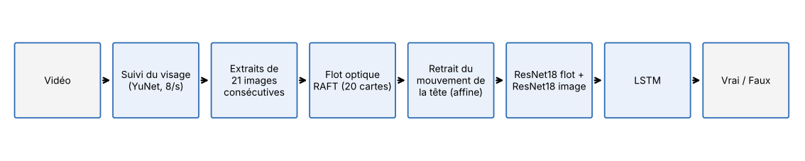

**En termes simples.** Le détecteur regarde de courts morceaux d'une vidéo, recadrés au plus près du
visage, et observe comment chaque point du visage bouge d'une image à la suivante. Un vrai visage bouge
d'un seul bloc. Un faux visage ressemble à un masque collé sur une vraie tête : quand la tête bouge, le
masque glisse, s'étire ou scintille parfois très légèrement. On montre au détecteur des milliers
d'exemples vrais et faux, et il apprend à repérer ces petits glissements. Il regarde aussi les images
du visage elles-mêmes, car un masque peut avoir des bords visibles ou des couleurs qui ne collent pas.

Le code se trouve dans le paquet `deepfake_flow` : `faces.py` et `preprocess.py` (étapes 1 à 3),
`flow.py` (étape 4 et transformations du flot de l'étape 5), `model.py` (étape 6), `data.py` et
`metrics.py` (découpages, jeu de données, métriques), `train.py` et `evaluate.py` (entraînement et
test), `predict.py` et `app.py` (étape 7 sur une nouvelle vidéo), `experiments.py` (toutes les
expériences dans l'ordre). L'organisation des fichiers est décrite dans le README.

---

## 2. Problèmes rencontrés et solutions

Un détecteur fondé sur le mouvement peut échouer, ou paraître meilleur qu'il ne l'est, de façons faciles
à manquer. Voici les problèmes rencontrés en construisant celui-ci, et la façon dont chacun est traité.

| # | Problème | Pourquoi c'est important | Solution | Section |
|---|---|---|---|---|
| 1 | **Échantillons quasi identiques et identités partagées entre ensembles** | Des fenêtres d'une même vidéo découpées avec chevauchement partagent la plupart de leurs cartes de flot. Réparties au hasard, les fenêtres de test sont en partie *les mêmes données* que celles d'entraînement, et la même personne apparaît des deux côtés. Les scores mesurent alors la mémoire, pas la détection. | Jusqu'à 6 extraits **sans chevauchement** par vidéo ; découpage par vidéo **et** par identité (DFD par acteur, listes officielles de FaceForensics++ et Celeb-DF) ; un contrôle dans le code arrête toute exécution dont le découpage place une vidéo ou une identité des deux côtés | §3.2, §8 |
| 2 | **Plage d'entrée de RAFT** | RAFT est entraîné sur des valeurs de pixels 0..255 qu'il ramène lui-même à −1..1. Des images dans 0..1 (valeur par défaut de `ToTensor()`) paraissent presque noires et uniformes, et le flot perd l'essentiel de sa précision. | Images transmises à RAFT dans 0..255 | §4 |
| 3 | **Mouvement de l'arrière-plan et de la caméra** | Le visage n'occupe qu'une petite partie de l'image : sur l'image entière, l'essentiel du flot décrit l'arrière-plan et la caméra. Écraser l'image en carré déforme aussi le visage différemment dans chaque vidéo. | Recadrages carrés qui suivent le visage, avec une marge × 1,3 | §3 |
| 4 | **Cadence** | Les défauts d'un échange de visage (scintillement, bords de fusion qui dérivent) apparaissent *entre images voisines*. Échantillonner à 5 images par seconde une vidéo à 25–30 saute 4 à 5 images par paire : les défauts se diluent, et le mouvement plus grand rend RAFT moins précis. | Flot entre images consécutives, à la cadence de la vidéo | §3 |
| 5 | **Normalisation du flot** | Diviser chaque carte par son propre écart-type efface l'ampleur du mouvement (un visage immobile et un visage qui bouge vite finissent à la même échelle) et amplifie le bruit des cartes presque sans mouvement. | Suppression du mouvement de la tête, puis une seule échelle pour tout le jeu de données | §5 |
| 6 | **Donner un flot à 2 canaux à un ResNet18 ImageNet** | Une nouvelle première couche aléatoire ne correspond plus aux couches pré-entraînées qui reposent sur elle. | Première couche initialisée à partir des filtres ImageNet, moyennés sur les canaux de couleur | §6 |
| 7 | **Couche supplémentaire inutile** | Une nouvelle `Linear(512, 512)` aléatoire après les descripteurs ajoute des paramètres à apprendre de zéro, sans aucun gain. | Pas de couche supplémentaire : les 512 descripteurs vont directement au LSTM | §6 |
| 8 | **Déséquilibre des classes et choix du modèle** | Les jeux de données contiennent plus de faux que de vrais, donc une perte non pondérée penche vers « faux » ; le F1 à un seuil fixe de 0,5 est bruité et dépend de ce seuil. | Perte pondérée par classe ; modèle retenu sur l'AUC vidéo de validation ; seuil choisi sur les vidéos de validation | §7 |
| 9 | **Unité de décision et métrique** | Une décision porte sur une vidéo, pas sur une fenêtre. L'exactitude seule dépend d'un seuil arbitraire et n'est pas comparable aux travaux publiés. | AUC au niveau vidéo avec intervalles bootstrap à 95 % ; le score d'une vidéo est la moyenne de ceux de ses extraits | §8 |
| 10 | **Démonstration cohérente avec l'entraînement** | Une démonstration doit charger le réseau entraîné et appliquer exactement le prétraitement de l'entraînement ; toute différence donne des réponses sans lien avec le modèle entraîné. Des fichiers temporaires partagés échouent aussi avec deux envois simultanés. | `predict.py` et `app.py` chargent le modèle sauvegardé complet et réutilisent le prétraitement de l'entraînement, avec un dossier temporaire par requête | `predict.py`, `app.py` |
| 11 | **Reproductibilité** | Sans graine fixe pour le chargement des données, les exécutions ne peuvent pas être reproduites à l'identique. | Graine 42 partout, cuDNN déterministe | §7 |

**En termes simples.** Un détecteur peut paraître excellent pour de mauvaises raisons, comme un élève qui
obtient une bonne note parce qu'une partie des questions de l'examen avait déjà été donnée, avec les
réponses, pendant les cours. Le protocole garantit que chaque vidéo de test, et chaque personne qui y
apparaît, est nouvelle pour le modèle. Les autres solutions garantissent que le mouvement mesuré est bien
celui du visage, et qu'il est mesuré avec précision.

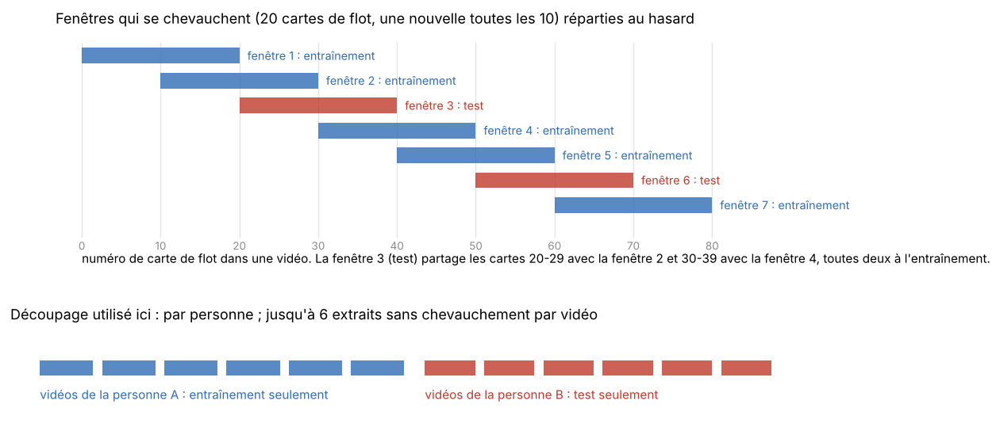

*Exemple du problème 1.* Une vidéo de 80 cartes de flot, découpée en fenêtres de 20 cartes avec une
nouvelle fenêtre toutes les 10 cartes, donne 7 fenêtres. Avec un découpage aléatoire, la fenêtre 3 pourrait
être en test alors que les fenêtres 2 et 4 sont en entraînement : les 20 cartes de la fenêtre 3 auraient
toutes été vues pendant l'entraînement. Si les autres vidéos de la même personne sont aussi en
entraînement, un modèle peut obtenir un bon score simplement en reconnaissant des personnes et des scènes
déjà vues. Ici, toutes les vidéos d'une personne sont du même côté, et les extraits d'une vidéo ne se
chevauchent jamais.

---

## 3. Prétraitement : décisions et justifications

Tous les réglages sont enregistrés dans `preprocess_config.json` dans chaque dossier de sortie ; le
script refuse de mélanger deux réglages différents dans un même dossier, si bien qu'un jeu de données ne
peut jamais être traité à moitié d'une façon et à moitié d'une autre.

| Réglage | Valeur | Justification |
|---|---|---|
| Détecteur de visages | **YuNet** d'OpenCV (`face_detection_yunet_2023mar.onnx`), score ≥ 0,6, appliqué sur des images réduites à 640 px sur le grand côté | Rapide, inclus dans OpenCV (aucune dépendance supplémentaire), et il renvoie la position des yeux, utilisée pour mesurer à quel point un visage est de face. La réduction à 640 px garde la détection rapide ; les cadres sont reconvertis en pixels de pleine résolution. |
| Fréquence d'analyse | **8 détections par seconde** | Détecter sur chaque image serait lent ; un visage bouge peu en 1/8 s, les cadres intermédiaires sont donc interpolés. |
| Suivi | une détection rejoint la trajectoire dont le dernier centre de cadre est le plus proche, s'il est à moins de **0,6 largeur de visage** et vu dans les **3 dernières images analysées** | Garde une trajectoire par personne même si le détecteur rate quelques images. |
| Sujet principal | la trajectoire avec la **plus grande surface totale de détections de face** | Dans les interviews, une seconde personne est souvent filmée de dos ou de profil ; elle ne doit pas être prise pour le sujet. Seuls les visages de face comptent. |
| Frontalité | distance entre les yeux / largeur du visage, minimum **0,25** | Des yeux éloignés dans l'image = un visage tourné vers la caméra. Les profils sont rejetés, car la moitié du visage (et de l'échange) est cachée. |
| Largeur minimale du visage | **80 px** (DFD, Celeb-DF), **50 px** (FaceForensics++) | Des visages plus petits donnent des recadrages flous et un flot peu fiable. Les vidéos de FaceForensics++ sont souvent en basse résolution ; à 80 px, 3 des 17 premières vidéos étaient rejetées, à 50 px seulement 1 de ses 1 000 vidéos réelles (§11, P5). |
| Dans l'image | le cadre du visage peut dépasser de l'image d'au plus 5 % de sa taille | Un visage à moitié hors de l'image serait surtout du remplissage noir. |
| Visage concurrent | une image est **ambiguë** si un autre visage a une frontalité ≥ **0,30** et au moins **50 %** de la surface du sujet | L'étiquette de la vidéo concerne une seule personne. Si deux personnes de taille semblable font face à la caméra, il est impossible de savoir automatiquement laquelle a été échangée ; ces images ne sont donc pas utilisées. |
| Longueur d'un extrait | **21 images consécutives → 20 cartes de flot** | Environ 0,7 à 0,8 s de vidéo (§3.4) ; images consécutives car les défauts d'échange apparaissent entre images voisines (§2, problème 4). |
| Extraits par vidéo | jusqu'à **6**, **sans chevauchement**, répartis sur la vidéo | Plusieurs moments de chaque vidéo, sans échantillons quasi identiques (§2, problème 1). |
| Cadence | celle de la vidéo (l'option `--fps` fixe une cadence plus basse pour comparaison) | Voir §2, problème 4. |
| Cadre de recadrage | interpolation linéaire entre les détections, **moyenne glissante sur 5 images**, carré (grand côté), agrandi ×**1,3** | L'interpolation donne un cadre sur chaque image ; le lissage supprime le tremblement du détecteur, qui apparaîtrait sinon comme un faux mouvement dans le flot ; la marge de 1,3 garde le bord du visage, où se trouve souvent la couture de fusion d'un échange. |
| Hors de l'image | rempli en **noir** | Ramener le cadre à l'intérieur de l'image déplacerait le visage dans le recadrage, ce qui crée un faux mouvement. |
| Taille du recadrage pour RAFT | **256 × 256** | Assez de détails pour RAFT ; RAFT exige des tailles divisibles par 8. |
| Taille enregistrée | **128 × 128** (flot et images du visage) | Taille lue par le réseau ; 4 fois moins d'espace disque et de mémoire graphique qu'en 256. |
| Stockage | flot en **float16**, images en **uint8**, un `.flow.npy` et un `.rgb.npy` par vidéo | float16 divise l'espace disque par deux avec une perte négligeable pour des mouvements de quelques pixels. |
| Journal | une ligne CSV par vidéo (utilisable ou non, pourquoi, taille du visage, durée) et une image d'aperçu par vidéo | Chaque exclusion est traçable ; les aperçus permettent de vérifier à l'œil que le bon visage a été recadré. |
| Sélection des vidéos | vidéos de test officielles toujours incluses (`--must_include`), le reste tiré au hasard de façon reproductible (graine 42) | Les jeux de test officiels restent complets ; le sous-échantillon est identique à chaque fois. |

**Pourquoi recadrer le visage ?** Tout ce qu'un échange de visage modifie se trouve dans la zone du
visage. Dans l'image entière, le visage n'occupe qu'une petite partie et l'essentiel du flot décrit
l'arrière-plan et la caméra, identiques dans les vraies et les fausses vidéos. Le recadrage fait
regarder le réseau uniquement là où se trouvent les indices.

**Pourquoi certaines vidéos sont-elles exclues ?** Une vidéo ne donne aucun extrait quand le visage
principal n'est jamais utilisable pendant 21 images consécutives : tourné, trop petit, hors de l'image
ou à côté d'un second visage de face. Ces vidéos sont consignées, comptées (§10.0) et signalées, pas
écartées en silence.

### 3.1 Détection et suivi des visages, étape par étape

Un détecteur de visages regarde **une seule image** et répond « il y a des visages ici, ici et ici »,
sous forme de cadres. Il ne sait pas que le cadre de l'image 10 et celui de l'image 11 sont la même
personne. Le suivi est l'étape qui les relie.

1. **Analyser.** Une image sur trois ou quatre (environ 8 par seconde), YuNet trouve tous les visages
   de l'image : un cadre pour chacun, la position des yeux et un score de confiance.
2. **Relier.** Les images sont parcourues dans l'ordre. Chaque visage trouvé dans une image est comparé
   aux personnes déjà connues : si son centre est proche de l'endroit où l'une d'elles a été vue pour la
   dernière fois (à moins de 0,6 largeur de visage) et que cette personne a été vue dans l'une des 3
   dernières images analysées, le visage est ajouté à la liste de cette personne. Sinon, il crée une
   nouvelle personne. Les plus grands visages sont reliés en premier, si bien que deux personnes ne
   prennent jamais le même cadre.
3. **Choisir le sujet principal.** La liste de chaque personne (sa « trajectoire ») reçoit un score : la
   taille totale de tous ses visages tournés vers la caméra. La personne au score le plus élevé est le
   sujet principal : celle qui fait le plus face à la caméra, en plus grand, le plus longtemps.
4. **Vérifier chaque image analysée.** Pour le sujet principal, chaque image analysée est marquée
   utilisable ou non (présent, assez de face, assez grand, dans l'image, et pas à côté d'un autre
   visage de face de taille semblable ; §3.3).

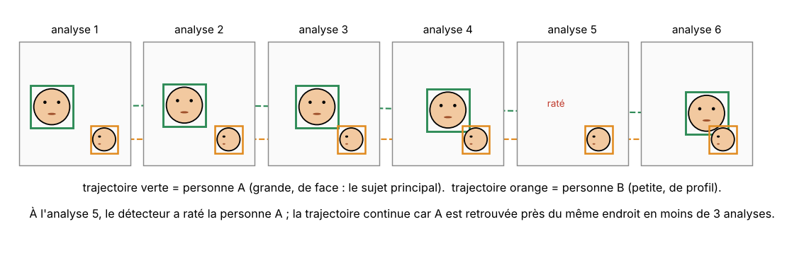

*Exemple.* Dans une interview, la personne A (l'invité) fait face à la caméra et la personne B
(l'intervieweur) est vue de profil. Après la liaison, il y a deux trajectoires. Les visages de A sont
grands et de face : A obtient un score bien plus élevé et devient le sujet principal. À l'analyse 5, le
détecteur a raté A un instant ; comme A est retrouvé près du même endroit en moins de 3 analyses, la
trajectoire continue simplement au lieu de créer une nouvelle personne.

**En termes simples.** Imaginez une photo de classe prise chaque seconde pendant la récréation. Un
détecteur entoure les visages sur chaque photo, mais il ne connaît pas les prénoms. Le suivi revient à
suivre chaque enfant d'une photo à l'autre selon l'endroit où il se tient : « l'enfant près de la
fenêtre sur la photo 1 est l'enfant près de la fenêtre sur la photo 2 ». À la fin, l'enfant qui a le
plus regardé l'appareil est celui dont parle la vidéo.

### 3.2 Les extraits : comment ils sont choisis, avec un exemple

Un **extrait** est un court morceau de la vidéo : 21 images qui se suivent sans qu'aucune ne soit sautée.

*Exemple.* Une vidéo de 10 secondes à 25 images par seconde compte 250 images. L'analyse trouve le
visage principal utilisable des images 20 à 110 et 150 à 235 ; entre les deux, la personne se détourne.
Le programme liste toutes les images de départ possibles dont les 21 images sont entièrement dans une
zone utilisable, puis choisit 6 départs répartis régulièrement parmi ces possibilités, sans jamais que
deux extraits partagent une image. Ici, cela donne 3 extraits dans la première zone et 3 dans la
seconde. Une vidéo avec une zone utilisable plus courte obtient moins d'extraits ; une vidéo sans
aucune zone de 21 images utilisables est exclue, et la raison est consignée.

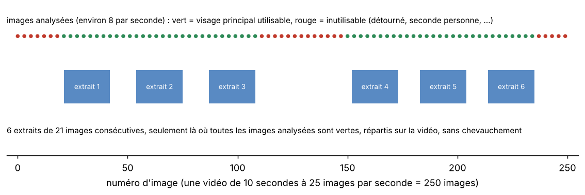

**Pourquoi 21 images.** Le détecteur compare chaque image à la suivante : 21 images donnent 20
comparaisons (20 cartes de flot). À 25–30 images par seconde, cela représente environ 0,7 à 0,8 seconde
de vidéo : assez long pour contenir plusieurs petits mouvements (un clignement, une syllabe, une légère
rotation), assez court pour qu'un lot de 4 extraits (80 cartes de flot et 80 images de visage) tienne
dans les 6 Go de la carte graphique pendant l'entraînement. Cette valeur a été choisie par ce
raisonnement, sans réglage fin ; des extraits plus longs sont une étude possible.

**Pourquoi jusqu'à 6 extraits par vidéo.** Un extrait peut être facile ou difficile par hasard ; 6
extraits pris à des moments différents donnent un verdict plus stable (le score d'une vidéo est la
moyenne de ses extraits). 6 × 21 images représentent environ 5 secondes par vidéo, ce qui garde
l'espace disque et le temps d'entraînement raisonnables pour des milliers de vidéos.

**En termes simples.** Une vidéo est comme une longue bande dessinée. Le programme découpe 6 petits
morceaux de 21 images chacun, seulement là où la personne principale est bien visible et seule, et ne
découpe jamais deux fois la même image. Chaque morceau est assez long pour voir quelques petits
mouvements, et assez court pour que l'ordinateur en traite beaucoup à la fois.

### 3.3 Mauvais recadrages et plusieurs personnes : ce qui a été observé et comment c'est corrigé

Avant de traiter un jeu de données complet, le prétraitement a été lancé sur deux petits dossiers de
test, et l'image d'aperçu de chaque vidéo (première et dernière image de chaque extrait) a été examinée.
Les problèmes suivants sont apparus :

| Ce que montraient les aperçus | Cause | Correction |
|---|---|---|
| **Le visage sortait du cadre** au cours d'un extrait, laissant un demi-visage ou l'arrière-plan | le cadre était fixe pour tout l'extrait, alors que la personne marchait ou se tournait | le cadre suit désormais le visage : détections sur environ 8 images par seconde, reliées en trajectoire, interpolées sur chaque image et lissées sur 5 images |
| **La mauvaise personne était recadrée** dans les scènes à deux personnes (par exemple un intervieweur et un invité, ou deux acteurs) | le code prenait « un visage », pas « le visage du sujet de la vidéo » | les visages sont reliés en une trajectoire par personne, et le sujet principal est la trajectoire avec la plus grande surface totale de visages **de face** sur toute la vidéo : la personne qui fait face à la caméra la plupart du temps |
| **Deux personnes face à la caméra** | l'étiquette « faux » concerne la personne échangée, et dans une telle image il est impossible de savoir automatiquement laquelle c'est | ces images sont marquées **ambiguës** (un autre visage d'au moins la moitié de la taille du sujet et de frontalité ≥ 0,30) et aucun extrait ne peut en contenir. Dans le second dossier de test, une vidéo avec deux personnes face à la caméra a bien été exclue pour cette raison |
| **Profils et visages détournés** | la moitié du visage, et de l'échange, est cachée | les images de frontalité inférieure à 0,25 ne sont pas utilisées |
| **Visages coupés par le bord de l'image**, avec une grande zone noire dans le recadrage | la personne était au bord de l'image | le cadre d'un visage peut dépasser de l'image d'au plus 5 % de sa taille |
| **Visages minuscules et flous** | la personne était loin de la caméra, ou la vidéo en basse résolution | les visages de moins de 80 px de large ne sont pas utilisés (50 px pour FaceForensics++, §11, P5) |

Chaque problème plus en détail :

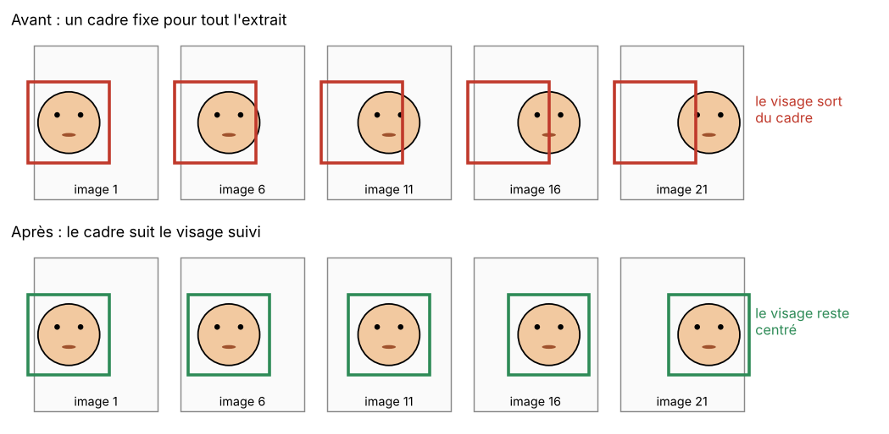

*Exemple 1, le visage sort du cadre.* Un premier essai de recadrage plaçait un
cadre par extrait, à partir de la première détection. Dans les aperçus de test, quand une personne
marchait ou se tournait pendant l'extrait, les dernières images montraient un demi-visage et une partie
de l'arrière-plan. Le flot optique d'un tel extrait décrit l'arrière-plan qui apparaît, pas le visage qui
bouge. Avec le suivi, le cadre se déplace à chaque image et le visage reste au centre du recadrage.

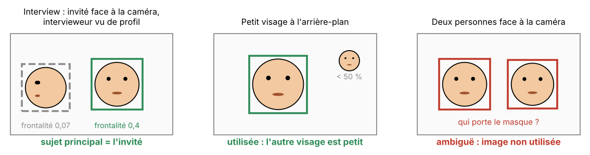

*Exemple 2, la mauvaise personne.* Les aperçus de test montraient des recadrages de la mauvaise personne
dans des scènes à deux personnes. Un cas typique est l'interview : la caméra montre l'intervieweur de
profil et l'invité de face. Prendre « un visage » pouvait donner l'intervieweur, qui n'est pas la
personne échangée : une vidéo fausse aurait alors été apprise à partir d'un vrai visage. La règle du
sujet principal choisit la personne qui fait le plus face à la caméra sur toute la vidéo : l'invité.

*Exemple 3, deux personnes face à la caméra.* Quand deux personnes de taille semblable font toutes deux
face à la caméra, il est impossible de savoir automatiquement laquelle porte le visage échangé. Ces
images ne sont pas utilisées ; une vidéo composée uniquement de telles images est exclue et consignée
comme « ambiguë ». C'est arrivé dans le second dossier de test, et c'est la cause d'exclusion la plus
fréquente dans les trois jeux de données.

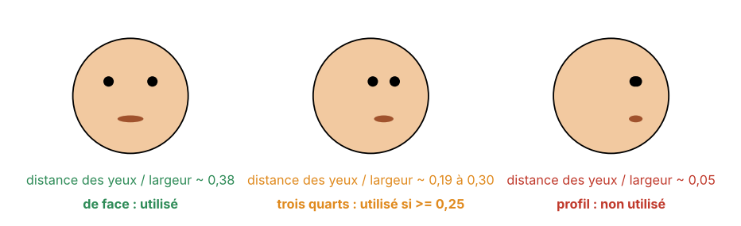

*Exemple 4, les profils.* Un visage vu de profil a les yeux rapprochés dans l'image. Le rapport distance
entre les yeux / largeur du visage le mesure ; en dessous de 0,25, l'image n'est pas utilisée. (Les
valeurs de la figure sont des exemples.)

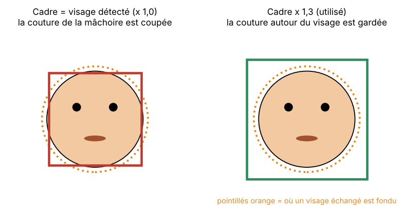

*Exemple 5, la marge.* Un échange de visage remplace l'intérieur du visage et le fond dans l'original sur
le pourtour (mâchoire, joues, front). Un recadrage exactement de la taille du visage détecté coupe ce
pourtour ; la marge de 1,3 le conserve.

Quand aucun intervalle de 21 images d'une vidéo ne respecte toutes ces règles, la vidéo est exclue et le
journal en indique la raison, avec le nombre d'images analysées rejetées pour chaque motif (absent,
profil, petit, hors image, ambigu). Après chaque jeu de données, ces motifs ont été comptés (§10.0) et
des images d'aperçu ont de nouveau été vérifiées par sondage : dans les trois jeux de données, la
plupart des exclusions sont des plans avec deux personnes face à la caméra.

### 3.4 Pourquoi ces valeurs ? (expliqué simplement)

Imaginez que la vidéo est un folioscope (un petit livre qu'on feuillette pour animer un dessin). Pour
décider si un visage est vrai ou faux, l'ordinateur regarde quelques pages du folioscope et observe
**comment le visage bouge d'une page à la suivante**. Un faux visage est un masque collé sur quelqu'un ;
quand la personne bouge, le masque glisse ou tremble parfois très légèrement entre deux pages. Les
valeurs ci-dessous décident quelles pages il regarde et comment il découpe le visage.

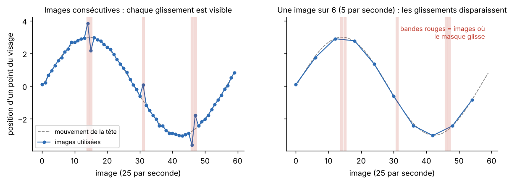

*Exemple : pourquoi des images consécutives.* La courbe montre la position d'un point du visage sur 60
images. La tête bouge régulièrement (pointillés), et le visage échangé glisse pendant une seule image, 5
fois (bandes rouges). En utilisant toutes les images (à gauche), chaque glissement est un saut visible. En
utilisant une image sur 6, comme en échantillonnant à 5 images par seconde (à droite), la plupart des
glissements tombent entre deux images utilisées et disparaissent.

| Valeur | Ce que c'est | Explication simple | Pourquoi cette valeur |
|---|---|---|---|
| **21 images** (20 cartes de flot) par extrait | longueur d'un extrait | l'ordinateur regarde 21 pages d'affilée et compare chaque page à la suivante : 20 comparaisons | à 25–30 images par seconde, 21 images font environ 0,7 à 0,8 seconde : assez pour voir plusieurs petits mouvements (un clignement, des mots prononcés), assez court pour tenir dans la mémoire de la carte graphique avec un lot de 4 extraits. |
| **Images consécutives** (sans saut) | quelles pages sont comparées | il compare la page 1 à la page 2, la page 2 à la page 3... pas la page 1 à la page 6 | le masque tremble entre pages voisines. Si on saute des pages, le tremblement se cache dans un grand mouvement, comme essayer de voir une mouche sur un train rapide. Échantillonner à 5 images par seconde sauterait 4 à 5 images |
| **Jusqu'à 6 extraits** par vidéo, sans chevauchement | combien de moments d'une vidéo sont utilisés | il regarde 6 moments différents de la vidéo, jamais deux fois les mêmes pages | plusieurs moments rendent la décision plus fiable (un extrait peut être facile ou difficile par hasard) ; sans chevauchement pour qu'aucune page ne compte deux fois ; 6 × 0,8 s ≈ 5 s de chaque vidéo sont utilisées, ce qui garde l'espace disque et le temps d'entraînement raisonnables |
| **8 recherches de visage par seconde** | à quelle fréquence on cherche le visage | il cherche le visage sur environ une page sur 3 ou 4, et devine où il se trouve sur les pages intermédiaires | un visage ne peut pas sauter loin en un huitième de seconde, donc l'estimation entre deux recherches est précise, et c'est 3 à 4 fois plus rapide que de chercher sur chaque page |
| **0,6 largeur de visage, 3 recherches** (suivi) | comment les visages sont reliés à une personne | si un visage, à la recherche suivante, est proche de l'endroit où se trouvait un visage (à moins d'un demi-visage environ), c'est la même personne, même si le détecteur l'a ratée pendant jusqu'à 3 recherches (environ 0,4 s) | une vraie personne ne se déplace pas de plus d'un demi-visage en un huitième de seconde ; tolérer 3 recherches ratées garde la même personne quand le détecteur « cligne des yeux » |
| **Frontalité 0,25** | à quel point le visage doit regarder la caméra | les deux yeux doivent être assez écartés dans l'image : vu de profil, quelqu'un a les yeux qui paraissent rapprochés | 0,25 garde les visages légèrement tournés (vues de trois quarts) et rejette les profils, où la moitié du visage est cachée |
| **0,30 et 0,5** (visage concurrent) | quand une seconde personne rend une image inutilisable | si un autre visage regarde aussi la caméra et est au moins moitié aussi grand, l'ordinateur ne peut pas savoir qui porte le masque | un petit visage au loin, ou un visage de profil, ne crée pas de confusion et est accepté ; seul un vrai concurrent pose problème |
| **80 px** (50 px pour FaceForensics++) | plus petite largeur de visage utilisée | si le visage est minuscule, l'agrandir le rend flou, et on ne voit pas un masque glisser sur un visage flou | 80 px gardent assez de détails une fois agrandis à 256 px ; les vidéos de FaceForensics++ sont de plus basse résolution, et à 80 px trop de bonnes vidéos étaient perdues, d'où 50 px pour ce jeu |
| **Lissage sur 5 images** | stabiliser le cadre | le cadre autour du visage tremble un peu car le détecteur n'est jamais exactement au même endroit ; faire la moyenne sur 5 pages le stabilise | le tremblement du cadre ressemblerait à un mouvement du visage, un faux tremblement. 5 images font environ 0,2 s : assez pour supprimer le tremblement, assez court pour suivre le vrai mouvement de la tête |
| **Marge × 1,3** | quelle zone autour du visage est gardée | le cadre est un peu plus grand que le visage, comme quand on laisse une bordure en découpant une image | le bord du masque, là où il est collé sur le vrai visage (mâchoire, front, joues), est l'endroit le plus probable d'une couture visible ; un cadre exactement de la taille du visage la couperait |
| **Remplissage noir** hors de l'image | ce qui remplit le recadrage quand le visage est près du bord | si une partie du cadre sort de l'image, cette partie reste noire au lieu de déplacer le cadre | déplacer le cadre déplacerait le visage dans le recadrage, ce qui ressemble aussi à un faux tremblement |
| **256 × 256 pour RAFT, 128 × 128 enregistrées** | taille de l'image | le visage est découpé en 256 × 256 pour mesurer le mouvement précisément, puis enregistré à mi-taille | RAFT exige des tailles divisibles par 8 et assez de détails ; 128 × 128 est la taille lue par le réseau et occupe 4 fois moins de place |

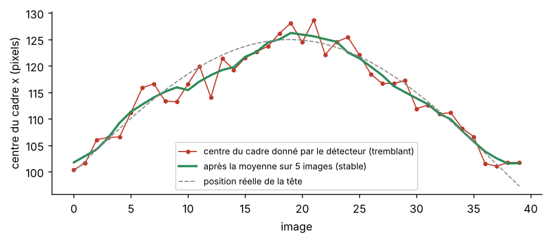

*Exemple : pourquoi lisser.* Le centre du cadre donné par le détecteur tremble de quelques pixels d'une
image à l'autre même quand la tête bouge régulièrement (en rouge). Sans lissage, ce tremblement
apparaîtrait dans le flot optique comme un visage qui tremble, dans les vraies comme dans les fausses
vidéos. La moyenne sur 5 images (en vert) suit la tête et supprime le tremblement.

Comment ces valeurs ont été choisies : par un raisonnement sur les vidéos et le matériel, et en
vérifiant les images d'aperçu ; elles n'ont **pas été réglées** en essayant de nombreuses valeurs pour
garder les meilleurs scores. Les modifier (par exemple des extraits plus longs, ou une autre cadence
avec `--fps`) est une étude possible.

---

## 4. Flot optique RAFT : réglages et justifications

**Ce qu'est le flot optique.** Le flot optique répond à une question pour deux images prises l'une après
l'autre : *où est allé chaque point de la première image dans la seconde ?* La réponse est une **carte de
flot** : pour chaque pixel, deux nombres, `dx` (de combien de pixels il s'est déplacé vers la gauche ou la
droite) et `dy` (vers le haut ou le bas). Une carte de flot a la même taille que l'image et deux
« canaux », dx et dy ; on peut donc la dessiner comme une flèche sur chaque point.

**Ce qu'est RAFT.** RAFT (*Recurrent All-Pairs Field Transforms*, Teed et Deng, ECCV 2020) est un réseau
de neurones qui calcule le flot optique. Il compare chaque point de la première image à chaque point de
la seconde, fait une première estimation du mouvement, puis l'améliore pas à pas (32 étapes de
raffinement ici). C'est l'une des méthodes de flot optique les plus précises disponibles, et ses poids
entraînés sont publics. Les poids utilisés ici (`raft-sintel`) ont été entraînés sur Sintel, un film
d'animation au mouvement réaliste et naturel.

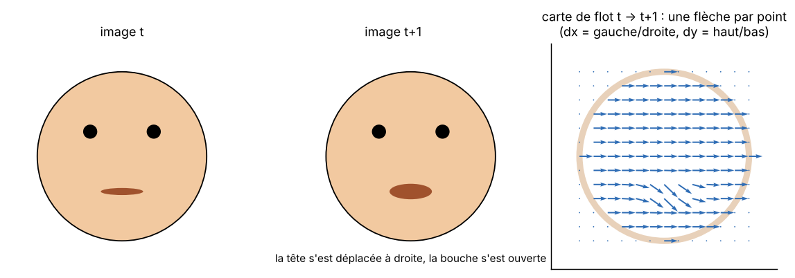

**Comment les 20 cartes de flot sont utilisées.** Pour chaque extrait de 21 recadrages du visage, RAFT
donne 20 cartes de flot : image 1 → 2, 2 → 3, ..., 20 → 21. Chaque carte fait 2 × 128 × 128 nombres une
fois enregistrée. Pendant l'entraînement, le mouvement de la tête est retiré de chaque carte (§5), elle
est mise à l'échelle, puis passe dans le ResNet18 du flot, qui la transforme en 512 nombres décrivant
son motif de mouvement. Les 20 descriptions, dans l'ordre, vont au LSTM, qui les lit comme les 20 étapes
d'une petite histoire et donne la probabilité que l'extrait soit faux (§6).

**À quoi doit ressembler le résultat.** Sur un vrai visage, une fois le mouvement de la tête retiré, le
flot restant est petit et régulier : la bouche s'ouvre, les yeux clignent, les joues bougent, et les
points voisins bougent ensemble. Sur un visage échangé, d'autres motifs peuvent apparaître : le bord du
visage collé qui bouge autrement que la peau autour, une bouche ou des yeux qui dérivent légèrement par
rapport au reste du visage, ou de petits scintillements d'une image à l'autre. On ne dit pas au réseau
quoi chercher ; il apprend lui-même, à partir des exemples d'entraînement, quels motifs distinguent le
vrai du faux.

**En termes simples.** Posez une minuscule flèche sur chaque tache de rousseur d'un visage dans une
image, pointant vers l'endroit où se trouve cette tache dans l'image suivante. L'ensemble de ces flèches
est une carte de flot. RAFT est un programme qui dessine toutes ces flèches très précisément. Sur un
vrai visage, les flèches de taches voisines pointent dans le même sens. Sur un faux visage, certaines
flèches près du bord du masque, de la bouche ou des yeux pointent un peu de travers, et le détecteur
apprend à le remarquer.

**Réglages et justifications :**

| | Réglage | Justification |
|---|---|---|
| Poids | Sintel | Sintel est le modèle de RAFT entraîné sur des scènes de film réalistes au mouvement naturel, plus proches de la vidéo que les données synthétiques « Chairs/Things » |
| Itérations | 32 | Réglage standard, précis |
| **Plage d'entrée** | **0..255** | RAFT attend 0..255 et ramène lui-même à −1..1 ; une entrée dans 0..1 donne des images presque noires (§2, problème 2) |
| Images d'entrée | recadrages du visage suivi, 256 × 256 | §3 |
| Paires d'images | images consécutives | §2, problème 4 |
| Lot | 10 paires à la fois | Plus rapide sur la carte graphique ; 10 paires tiennent dans 6 Go |
| Précision | précision mixte, résultat converti en float32 avant redimensionnement | Évite les arrondis lors du redimensionnement |
| Redimensionnement | flot redimensionné de 256 à 128 par interpolation bilinéaire, valeurs conservées en pixels du recadrage 256 | Mêmes unités pour toutes les vidéos ; l'échelle est gérée plus loin (§5) |
| Stockage | un fichier par vidéo, float16 | Des milliers de petits fichiers sont lents à lire ; un tableau par vidéo se charge en une fois |

---

## 5. Suppression du mouvement de la tête dans le flot

**Le problème.** Dans une carte de flot d'un recadrage du visage, l'essentiel du mouvement vient de la
tête qui bouge (rotation, hochement, rapprochement) et du cadre qui la suit. Ce mouvement est le même
dans les vraies et les fausses vidéos. Le mouvement qui diffère est petit et situé à l'intérieur du
visage : la bouche et les yeux d'un visage échangé peuvent ne pas bouger de façon cohérente avec le
reste, la peau peut scintiller, le bord de fusion peut dériver. Le grand mouvement rigide masque ces
petits signaux.

**La méthode.** Pour chaque carte de flot, les mouvements horizontal et vertical sont ajustés par une
**fonction affine de la position du pixel** (`dx ≈ a·x + b·y + c`, `dy ≈ d·x + e·y + f`, avec x et y dans
[−1, 1]) par moindres carrés, puis l'ajustement est soustrait. Un mouvement affine couvre la
translation, la rotation dans le plan, le zoom et le cisaillement : exactement l'allure du déplacement du
cadre (translation et zoom) et de l'essentiel du mouvement rigide d'une tête dans un petit recadrage. Ce
qui reste est le **mouvement résiduel, non rigide, du visage**. L'ajustement utilise une pseudo-inverse
précalculée et ne coûte donc presque rien pendant l'entraînement.

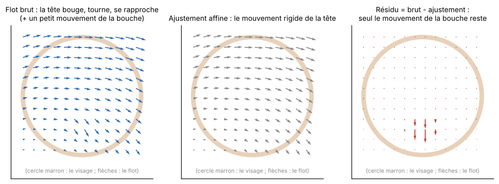

*Exemple.* La figure est produite avec la fonction `compensate_motion` du projet sur un champ de flot
construit : la tête se déplace vers la droite, tourne un peu et se rapproche (à gauche), et la bouche
s'ouvre (un petit mouvement vers le bas en bas du visage). L'ajustement affine (au milieu) capte le
mouvement de la tête ; le résidu (à droite) est presque nul partout sauf au niveau de la bouche. C'est ce
résidu que reçoit le réseau.

**Étape par étape, avec des chiffres.** Prenons une carte de flot : pour chaque point (x, y) du recadrage,
le mouvement (dx, dy) mesuré par RAFT. Les positions sont notées entre −1 (bord gauche ou haut) et +1
(bord droit ou bas).

1. Supposons que toute la tête se déplace de 3 pixels vers la droite entre deux images. Chaque point a
   dx = 3, dy = 0. Le meilleur ajustement affine est simplement « tout se déplace de 3 vers la droite »
   (c = 3, tous les autres coefficients à 0). Le soustraire laisse 0 partout : rien à voir, comme prévu
   pour un pur mouvement de tête.
2. Maintenant, la tête se rapproche aussi un peu de la caméra. Les points à droite du visage se
   déplacent un peu plus vers la droite, ceux de gauche un peu vers la gauche : dx augmente avec x
   (a > 0), dy augmente avec y (e > 0). C'est un zoom, que l'ajustement affine capte aussi.
3. Maintenant, en plus, la bouche s'ouvre : seuls les points de la bouche descendent de 1 pixel.
   L'ajustement affine est calculé sur tout le visage, donc ce petit mouvement local le modifie à peine.
   Après soustraction, chaque point est proche de 0 **sauf la bouche**, qui garde son mouvement de
   1 pixel vers le bas. C'est ce résidu que reçoit le réseau.

**Ce que signifient les six coefficients.** Dans `dx ≈ a·x + b·y + c` et `dy ≈ d·x + e·y + f` : `c` et
`f` sont un décalage gauche/droite et haut/bas ; `a` et `e` un étirement (zoom avant ou arrière) ; `b` et
`d` une rotation ou un cisaillement. Ensemble, ils décrivent comment une image plane peut bouger d'un
seul bloc, ce qui est la façon dont bouge un recadrage du visage quand la tête bouge et que le cadre la
suit.

**Formulation mathématique.** Une carte de flot de 128 × 128 points contient N = 16 384 vecteurs
(dx_i, dy_i). La matrice de conception A (N lignes, 3 colonnes) a pour ligne i le vecteur [x_i, y_i, 1],
avec x_i et y_i les coordonnées du point ramenées dans [−1, 1]. Les coefficients de moindres carrés sont
θ_x = A⁺ · dx et θ_y = A⁺ · dy, où A⁺ = (Aᵀ A)⁻¹ Aᵀ est la pseudo-inverse de Moore-Penrose de A. Comme la
grille est la même pour toutes les cartes, A⁺ (3 × 16 384) est calculée une seule fois et mise en cache ;
chaque ajustement se réduit à deux produits matrice-vecteur. Le résidu transmis au réseau est
r_x = dx − A · θ_x et r_y = dy − A · θ_y. Avec le réglage `mean`, le résidu est simplement
r_x = dx − moyenne(dx) et r_y = dy − moyenne(dy) ; avec `none`, r = d.

**Trois réglages** sont conservés pour comparaison (`--motion`) :
- `none` : flot brut ;
- `mean` : soustraction du déplacement moyen seulement (uniquement `c` et `f` : translation) ;
- `affine` : soustraction de l'ajustement affine complet (les six coefficients).

**Ce qu'ont montré les expériences** (§10.5) : soustraire seulement le déplacement moyen a le mieux
généralisé aux jeux de données non vus (0,870 sur DFD et 0,739 sur Celeb-DF, contre 0,820 et 0,719 pour
la suppression affine, et 0,824 et 0,687 sans suppression). Une explication probable, encore à tester :
l'ajustement affine retire aussi une partie du signal utile. Une mâchoire qui s'abaisse ou des joues qui
s'étirent déplacent de nombreux points du visage à la manière d'un zoom ou d'une rotation ; l'ajustement
affine en traite une partie comme du « mouvement de tête » et les soustrait. Ne retirer que la
translation supprime le glissement de la tête et du cadre, qui est la partie la plus grande et la moins
informative, et garde tout le reste. Ces résultats proviennent d'un seul entraînement par réglage et
doivent être répétés avec d'autres graines.

**En termes simples.** Quand quelqu'un marche en parlant, tout son visage glisse dans l'image. Ce grand
glissement est le même pour les vrais et les faux visages, et il cache les minuscules glissements d'un
masque. Retirer le mouvement de la tête revient à tenir la caméra de façon que le visage reste immobile
dans l'image, pour qu'il ne reste que les petits mouvements à l'intérieur du visage : la bouche, les
yeux, et peut-être le masque qui glisse. Les expériences montrent qu'il vaut mieux retirer seulement le
glissement, et ne pas essayer de retirer tous les types de mouvement de tête, car cela retire aussi une
partie des mouvements propres du visage.

**Mise à l'échelle.** Au lieu de standardiser chaque carte séparément (§2, problème 5), chaque carte
de flot est divisée par **un seul nombre pour tout le jeu de données** : la moyenne quadratique du flot
compensé sur 200 extraits d'entraînement tirés au hasard (graine 42). Cela permet de distinguer un visage
immobile d'un visage qui bouge. Ce nombre est calculé uniquement sur les extraits d'entraînement et
enregistré avec le modèle, si bien que la validation, le test et les tests sur d'autres jeux de données
utilisent exactement la même échelle.

**Augmentation par retournement.** Pendant l'entraînement, un extrait est retourné de gauche à droite
avec une probabilité de 0,5. Pour le flot, les cartes sont retournées **et dx change de signe**, car un
mouvement vers la droite devient un mouvement vers la gauche dans un miroir. Les images du visage sont
retournées de la même façon.

---

## 6. Le réseau : ResNet18 et LSTM, et justifications

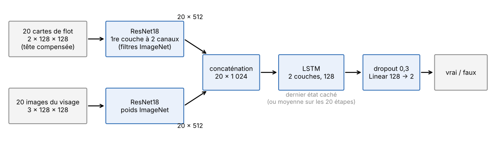

| Partie | Réglage | Justification |
|---|---|---|
| Encodeur du flot, première couche | convolution à 2 canaux **initialisée à partir des filtres ImageNet** : chaque nouveau filtre = le filtre pré-entraîné moyenné sur ses 3 canaux de couleur, copié sur les deux canaux du flot | La couche part de détecteurs de bords et de textures déjà entraînés, cohérents avec les couches pré-entraînées au-dessus (§2, problème 6) |
| Encodeur du flot, dernière couche | `Identity` : les 512 descripteurs vont directement au LSTM | Aucune couche supplémentaire à apprendre de zéro (§2, problème 7) |
| Flux d'apparence | un second ResNet18 (poids ImageNet) sur l'image du visage de chaque étape ; images divisées par 255 et normalisées avec la moyenne et l'écart-type d'ImageNet | Le flot montre comment le visage bouge ; l'image montre à quoi il ressemble (textures, bords de fusion, différences de couleur). Les détecteurs publiés reposent surtout sur l'apparence. Disposer des deux permet de mesurer l'apport de chacun (§10.5). L'image *t* est associée au flot de *t* à *t*+1. |
| Fusion | les deux descripteurs de 512 valeurs de chaque étape sont concaténés (1 024 valeurs) | Simple et transparent : le LSTM voit les deux à chaque étape |
| LSTM | 2 couches, taille cachée 128, dropout 0,1 entre couches, dernier état caché | Assez petit pour la taille des jeux de données |
| Dropout avant le classifieur | 0,3 | L'entrée compte 1 024 valeurs et le modèle sur-apprend vite (§10.2) |
| Classifieur | Linear(128, 2) | |
| Tête temporelle (option) | `--temporal mean` : moyenne des 20 descripteurs d'étape, sans LSTM | Pour tester si l'ordre des étapes compte (§10.5) |
| Mode (option) | `--mode two_stream`, `flow` ou `rgb` | Pour mesurer l'apport de chaque flux (§10.5) |

**Taille du modèle** (paramètres entraînables, comptés sur le code) :

| Version | Paramètres |
|---|---|
| Deux flux + LSTM (modèle complet) | 23 073 090 |
| Deux flux + moyenne dans le temps | 22 351 938 |
| Flot seul + LSTM | 11 634 434 |
| Images seules + LSTM | 11 637 570 |

Chaque ResNet18 sans sa couche de classification compte environ 11,2 millions de paramètres ; le LSTM et
le classifieur environ 0,7 million. Un fichier `best.pth` occupe environ 92 Mo (45 Mo pour une version à
un seul flux).

**Rôle de chaque partie.**
- **ResNet18** est un réseau standard de reconnaissance d'images à 18 couches, ici pré-entraîné sur
  ImageNet (1,2 million de photos). Il transforme une image en 512 nombres qui décrivent son contenu. Une
  copie lit la carte de flot de chaque étape, une autre l'image du visage de chaque étape.
- **LSTM** (*long short-term memory*, mémoire à long et court terme) est un réseau qui lit une séquence
  une étape à la fois et garde en mémoire ce qu'il a vu. Il lit les 20 étapes d'un extrait dans l'ordre
  et, à la fin, sa mémoire contient un résumé de tout l'extrait, à partir duquel la dernière couche
  donne « réel » ou « faux ».

**Pourquoi deux flux.** Le flot et l'image du visage apportent des indices différents. Le flot montre
*comment* le visage bouge (§4) ; l'image montre *à quoi il ressemble* : bords de fusion, flou, texture
de la peau, différences de couleur entre le visage collé et le cou. La plupart des détecteurs publiés
reposent uniquement sur l'apparence ; la question de ce projet est de savoir si le mouvement apporte
quelque chose. Une architecture à deux flux, introduite pour la reconnaissance d'actions par Simonyan et
Zisserman (2014), est la façon la plus simple de combiner les deux et surtout, ici, de mesurer chacun : le
même réseau peut être entraîné avec un seul flux (`--mode flow` ou `--mode rgb`) puis comparé.

**Est-ce la meilleure architecture ?** Ce n'est pas démontré, et les résultats indiquent qu'elle n'est
pas nettement meilleure que l'apparence seule :
- Sur DFD, les deux flux ensemble obtiennent 0,820 contre 0,798 pour les images seules, et 0,870 avec la
  suppression du mouvement moyen : ici, le mouvement aide.
- Sur Celeb-DF, les images seules obtiennent 0,738 contre 0,719 pour le modèle complet ; la différence
  est à l'intérieur des intervalles.
- Le flot seul généralise mal (0,596 sur Celeb-DF).

Le réseau à deux flux est donc un choix raisonnable et transparent qui a permis ces mesures, pas un
optimum démontré. Il existe dans la littérature des alternatives plus performantes : fusionner les deux
flux plus tard ou par attention, des réseaux convolutifs 3D qui lisent plusieurs images à la fois, ou
des transformers vidéo. Les meilleurs résultats publiés sur Celeb-DF (par exemple AltFreezing et
PhaseForensics, §10.4) utilisent ce type d'architecture.

**En termes simples.** Le détecteur a deux paires d'yeux. L'une regarde les photos du visage, comme pour
vérifier si un masque a des bords visibles. L'autre ne regarde que les flèches de mouvement, comme pour
vérifier si le masque glisse. Une troisième partie, le LSTM, observe les deux séries d'observations un
moment après l'autre, comme on lit une bande dessinée, et décide à la fin si le visage était vrai. Avoir
deux paires d'yeux a permis de tester laquelle est la plus utile.

---

## 7. Entraînement : hyperparamètres et justifications

| Réglage | Valeur | Justification |
|---|---|---|
| Optimiseur | AdamW | Standard pour affiner des réseaux pré-entraînés |
| Taux d'apprentissage | 1e-4 | Valeur standard pour affiner des ResNet pré-entraînés |
| Weight decay | 1e-4 | Régularisation légère |
| Taille de lot | 4 | Mémoire graphique (6 Go) : un extrait = 20 cartes de flot + 20 images |
| Accumulation de gradient | 4 (lot effectif de 16) | Mises à jour plus stables avec un petit lot ; le dernier groupe incomplet de lots d'une époque est aussi appliqué |
| Précision mixte | oui | plus rapide, moins de mémoire |
| Perte | entropie croisée **pondérée par classe**, poids de la classe c = n / (2 × n_c) sur l'ensemble d'entraînement | DFD compte environ 2,7 faux par vraie vidéo, FaceForensics++ (tel qu'utilisé ici) 1,2 ; sans pondération, le modèle penche vers « faux » |
| Époques | jusqu'à **30** | marge pour converger ; l'arrêt anticipé termine généralement bien avant |
| Arrêt anticipé | patience **5** | les scores de validation varient d'une époque à l'autre (§10.2) ; une patience plus courte s'arrête à cause du bruit |
| Sélection du modèle | **AUC au niveau vidéo sur la validation** | L'AUC ne dépend pas d'un seuil et c'est la métrique de l'article ; le niveau vidéo correspond à la décision réelle |
| Seuil de décision | **choisi sur les vidéos de validation** (maximum de taux de vrais positifs − taux de faux positifs, indice J de Youden), enregistré avec le modèle | à 0,5, des acteurs réels avec des scores de 0,52 à 0,62 devenaient de fausses alertes (§10.1) |
| Augmentation | retournement horizontal, p = 0,5 (§5) | la seule augmentation utilisée |
| Graine | **42** pour Python, NumPy, PyTorch et chaque processus de chargement ; cuDNN déterministe | les exécutions peuvent être reproduites à l'identique (confirmé au §10.1) |
| Processus de chargement | 2 | |

**En termes simples.** L'entraînement ressemble à un élève qui fait des exercices et vérifie ses
réponses. Une **époque** est un passage sur tous les exercices d'entraînement. Après chaque exercice, le
réseau ajuste un peu ses réglages dans la direction qui aurait donné une meilleure réponse ; le **taux
d'apprentissage** (0,0001) est la taille de chaque ajustement, gardée petite pour ne pas dépasser le but.
La **perte** mesure à quel point les réponses étaient fausses, en comptant autant les faux que les vrais
même s'il y a plus de faux. Après chaque époque, le réseau passe un contrôle sur des vidéos sur
lesquelles il ne s'entraîne pas (l'ensemble de validation) ; la meilleure époque à ce contrôle est
conservée, et l'entraînement s'arrête quand 5 époques d'affilée n'apportent aucune amélioration (**arrêt
anticipé**), car à partir de là l'élève apprend les exercices par cœur au lieu de comprendre. La
**graine** fixe tous les choix aléatoires, si bien que la même exécution redonne exactement le même
résultat.

---

## 8. Protocole d'évaluation

- **Aucune identité des deux côtés d'un découpage.** DFD et Celeb-DF sont découpés par identité (la
  partie du nom de fichier avant le premier `_` : l'acteur de DFD, la célébrité de Celeb-DF).
  FaceForensics++ utilise son découpage officiel des vidéos sources (le faux `000_003` reste avec les
  vraies vidéos `000` et `003`). Le code le vérifie après chaque découpage et s'arrête en cas de
  violation.
- **Ce sont les vidéos qui sont réparties, jamais les extraits.** Tous les extraits d'une vidéo sont du
  même côté.
- **DFD :** validation croisée à 7 plis, groupée par acteur et stratifiée par classe
  (`StratifiedGroupKFold` de scikit-learn, graine 42) ; dans chaque pli, environ 15 % des acteurs
  d'entraînement sont mis de côté pour la validation. Chaque vidéo est testée exactement une fois, par un
  modèle qui n'a jamais vu cet acteur.
- **Celeb-DF :** la liste officielle de 518 vidéos de test.
- **FaceForensics++ :** le découpage officiel 720 / 140 / 140.
- **Métriques,** avec « faux » comme classe positive : AUC, exactitude, exactitude équilibrée, précision,
  rappel, F1, taux de fausses alertes (vraies vidéos déclarées fausses) et matrice de confusion, au niveau
  extrait et au niveau vidéo (moyenne des probabilités des extraits). Pour l'AUC vidéo, un intervalle à
  95 % obtenu par 1 000 rééchantillonnages bootstrap des vidéos de test.
- **Entre jeux de données :** un modèle entraîné est testé tel quel sur un autre jeu de données (même
  échelle de flot, même seuil, aucun réentraînement). Les résultats sont donnés en AUC, car un seuil
  choisi sur un jeu de données ne se transfère pas à un autre (§10.3).

**En termes simples.**
- **Découpages.** Les vidéos sont réparties en trois groupes : un pour apprendre (entraînement), un pour
  choisir la meilleure version et la règle de décision (validation), et un utilisé une seule fois, tout à
  la fin (test). Une personne qui apparaît dans un groupe n'apparaît jamais dans un autre, donc le
  détecteur ne peut pas réussir le test en reconnaissant des visages déjà vus.
- **Validation croisée à 7 plis.** Les acteurs de DFD sont répartis en 7 groupes ; le détecteur est
  entraîné 7 fois, testé à chaque fois sur un groupe différent, si bien que chaque vidéo est testée une
  fois et qu'aucun groupe chanceux ne décide seul du résultat.
- **AUC.** Le détecteur donne à chaque vidéo un score entre 0 (sûrement vraie) et 1 (sûrement fausse).
  L'AUC est la probabilité qu'une vidéo fausse tirée au hasard obtienne un score plus élevé qu'une vraie
  tirée au hasard : 1,0 est parfait, 0,5 équivaut à pile ou face. Elle ne dépend pas de l'endroit où l'on
  trace la limite entre « vrai » et « faux ».
- **Seuil.** Pour répondre par oui ou non, il faut tracer une limite : au-dessus, « faux ». La limite est
  placée là où elle sépare le mieux les vidéos de validation, jamais en regardant les vidéos de test.
- **Intervalle à 95 %.** Le test est répété 1 000 fois sur des tirages aléatoires des vidéos de test, pour
  voir de combien l'AUC changerait avec des vidéos légèrement différentes ; la vraie valeur se trouve
  très probablement dans l'intervalle. Quand les intervalles de deux versions se chevauchent beaucoup,
  la différence entre elles peut être due au hasard.

**Définitions formelles.**
- *Perte.* Pour un lot de n extraits d'étiquettes y_i ∈ {réel, faux} et de probabilités prédites p_i,
  L = − Σ_i w_{y_i} · log p_i(y_i) / Σ_i w_{y_i}, avec w_c = n_total / (2 · n_c) calculé sur les extraits
  d'entraînement (n_c : nombre d'extraits de la classe c). C'est l'entropie croisée pondérée de PyTorch.
- *Score d'une vidéo.* P_v = (1 / K_v) · Σ_k p_k(faux), la moyenne des probabilités « faux » de ses K_v
  extraits (K_v ≤ 6).
- *AUC.* Avec n₊ vidéos fausses et n₋ vraies, AUC = (1 / (n₊ · n₋)) · Σ_i Σ_j [ 1(P_i > P_j) + ½ · 1(P_i = P_j) ],
  i parcourant les fausses et j les vraies (statistique de Mann-Whitney) ; calculée avec scikit-learn.
- *Seuil.* τ* = argmax_τ [ TPR(τ) − FPR(τ) ] sur les points de la courbe ROC des vidéos de validation
  (indice J de Youden), TPR étant le taux de faux détectés et FPR le taux de vraies vidéos déclarées
  fausses. Maximiser J revient à maximiser l'exactitude équilibrée (TPR + TNR) / 2.
- *Intervalle bootstrap.* 1 000 tirages avec remise de l'ensemble des vidéos de test (même taille, graine
  0), AUC recalculée à chaque tirage ; l'intervalle va du 2,5e au 97,5e centile (intervalle des centiles).
  Les rares tirages ne contenant qu'une classe sont ignorés.
- *Échelle du flot.* s = sqrt( (1/M) · Σ r² ), la somme portant sur toutes les valeurs (2 canaux, 20 cartes,
  128 × 128 points) de 200 extraits d'entraînement tirés au hasard (graine 42) ; M est le nombre de
  valeurs. L'entrée du réseau est r / s.

---

## 9. Jeux de données

Trois jeux de données publics sont utilisés. Ils doivent être demandés à leurs auteurs et ne sont pas
inclus dans le dépôt. Les trois sont utilisés dans leur version **c23** lorsqu'elle existe : des vidéos
compressées en H.264 avec un facteur de qualité constant de 23, une compression légère proche de celle
des plateformes vidéo.

### 9.1 DFD (DeepFakeDetection, Google et Jigsaw, 2019)

- **Ce que c'est.** Des acteurs rémunérés, ayant donné leur consentement, ont été filmés dans 16 scènes de
  la vie courante (parler contre un mur, marcher dans un couloir, une cuisine, une réunion, une
  accolade, etc.). Les faux ont été créés par échange de visage : dans chaque faux, le visage d'un acteur
  est remplacé par celui d'un autre acteur.
- **Taille.** 363 vraies vidéos de 28 acteurs, 3 068 faux.
- **Structure.** Distribué avec FaceForensics++ :
  - vraie vidéo : `original_sequences/actors/c23/videos/01__exit_phone_room.mp4` (acteur 01, scène
    « exit phone room ») ;
  - fausse vidéo : `manipulated_sequences/DeepFakeDetection/c23/videos/02_03__walking_outside_cafe_disgusted__QH3Y0IG0.mp4`
    (une vidéo de l'acteur 02 dans cette scène, avec le visage de l'acteur 03 ; la dernière partie est
    un identifiant).
- **Identité utilisée pour le découpage.** Le numéro avant le premier `_` (l'acteur de la vidéo
  d'origine), pour que toutes les vidéos d'un acteur, vraies et fausses, restent du même côté.
- **Utilisé ici.** Les 363 vraies vidéos et 1 000 faux (tirés au hasard, graine 42) ; 354 vraies et 956
  fausses vidéos utilisables (§10.0).

### 9.2 Celeb-DF v2 (Li et al., CVPR 2020)

- **Ce que c'est.** Des interviews de célébrités tirées de YouTube, et des échanges de visage entre elles
  créés avec une méthode améliorée pour réduire les défauts visibles (différences de couleur,
  scintillement, bords flous). C'est un jeu de test réputé difficile.
- **Taille.** 590 vraies vidéos de 59 célébrités (`Celeb-real`), 300 autres vraies vidéos YouTube
  (`YouTube-real`), 5 639 faux (`Celeb-synthesis`).
- **Structure.**
  - `Celeb-real/id0_0000.mp4` : la vidéo 0000 de la célébrité 0 ;
  - `Celeb-synthesis/id0_id1_0000.mp4` : la même vidéo 0000 de la célébrité 0, avec le visage de la
    célébrité 1 ;
  - `YouTube-real/00000.mp4` : une vraie vidéo supplémentaire ;
  - `List_of_testing_videos.txt` : l'ensemble de test officiel, 518 lignes de la forme
    `1 Celeb-real/id0_0004.mp4` (dans ce fichier, 1 = vraie et 0 = fausse).
- **Identité utilisée pour le découpage.** Le texte avant le premier `_` (`id0`), pour que les vraies
  vidéos d'une célébrité et les faux construits à partir d'elles restent ensemble.
- **Utilisé ici.** Comme jeu de test non vu : les 518 vidéos de test officielles (510 utilisables). Les
  890 vraies vidéos et 1 500 faux (dont les 340 faux de test) ont été prétraités.

### 9.3 FaceForensics++ (Rössler et al., ICCV 2019)

- **Ce que c'est.** 1 000 vidéos YouTube, surtout des journaux télévisés et des interviews avec un visage
  bien visible. Chaque vidéo a été manipulée avec 4 méthodes :
  - **Deepfakes** : échange de visage par un réseau de neurones (auto-encodeur) ;
  - **FaceSwap** : échange de visage avec un modèle 3D du visage et de l'infographie ;
  - **Face2Face** : le visage est conservé, mais ses expressions sont remplacées par celles d'une autre
    vidéo (méthode infographique) ;
  - **NeuralTextures** : les expressions, surtout la bouche, sont recalculées par un réseau de neurones.
- **Taille.** 1 000 vraies vidéos et 1 000 faux par méthode (4 000 faux).
- **Structure.**
  - vraie vidéo : `original_sequences/youtube/c23/videos/000.mp4` ;
  - fausse vidéo : `manipulated_sequences/Deepfakes/c23/videos/000_003.mp4` (la vidéo 000 avec le visage,
    ou les expressions, de la vidéo 003) ; les mêmes noms existent pour chaque méthode, ils sont donc
    enregistrés dans ce projet sous la forme `DF-000_003`, `F2F-000_003`, `FS-000_003`, `NT-000_003` ;
  - découpage officiel : `train.json`, `val.json`, `test.json`, des listes de paires de numéros de vidéos
    (720 / 140 / 140 vidéos).
- **Identité utilisée pour le découpage.** Le découpage officiel, qui garde les deux vidéos de chaque
  paire du même côté.
- **Utilisé ici.** Pour l'entraînement : 1 000 vraies vidéos et 500 faux par méthode (les 280 faux de
  validation et de test de chaque méthode, plus 220 faux d'entraînement) ; 991 vraies et 1 976 fausses
  vidéos utilisables.

| Jeu de données | Vraies | Fausses | Méthodes de falsification | Rôle ici |
|---|---|---|---|---|
| DFD | 363 | 3 068 | 1 échange de visage | entraînement (7 plis) et test non vu |
| Celeb-DF v2 | 890 | 5 639 | 1 échange de visage amélioré | test non vu (liste officielle) |
| FaceForensics++ | 1 000 | 4 000 | 2 échanges de visage, 2 modifications d'expression | entraînement (découpage officiel) |

**En termes simples.** Le détecteur apprend à partir d'exemples, comme un élève qui apprend à repérer les
faux billets en regardant beaucoup de vrais et de faux billets. FaceForensics++ est le manuel principal :
des contrefaçons faites de quatre façons différentes. DFD et Celeb-DF sont des examens surprises préparés
par d'autres faussaires avec d'autres outils : ils montrent si l'élève a vraiment compris ce qui trahit
une contrefaçon, ou s'il a seulement appris le manuel par cœur.

## 10. Résultats

**Comment lire les chiffres.** Tous les scores sont des **AUC** (§8) : 1,0 signifie que chaque vidéo
fausse a un score plus élevé que chaque vraie, 0,5 ne fait pas mieux que pile ou face. Les résultats sur
un « jeu de données vu » (entraînement et test sur le même jeu de données, avec des personnes
différentes) montrent à quel point le détecteur a appris ce type de faux. Les résultats sur un « jeu de
données non vu » (jamais utilisé à l'entraînement) montrent s'il a appris quelque chose de général ; ce
sont eux qui comptent pour un usage réel. Les nombres entre parenthèses sont des intervalles à 95 %.

### 10.0 Prétraitement : vidéos utilisables

| Jeu de données | Vraies utilisables | Fausses utilisables | Principales causes d'exclusion |
|---|---|---|---|
| DFD | 354 / 363 | 956 / 1 000 | deux personnes dans le plan, visage détourné, trop courte |
| Celeb-DF | 863 / 890 | 1 483 / 1 500 | aucun visage de face utilisable sur 21 images, deux personnes |
| FaceForensics++ | 991 / 1 000 | 1 976 / 2 000 (494 par méthode) | deux personnes dans le plan |

Liste de test officielle de Celeb-DF : 510 des 518 vidéos utilisables (107/108 Celeb-real, 67/70
YouTube-real, 336/340 faux). Ensemble de test de FaceForensics++ : 695 des 700 utilisables (139 vraies,
556 fausses). Tous les résultats sur ces ensembles portent sur les vidéos utilisables.

Temps de traitement : environ 8 s par vidéo pour DFD, 4,6 s pour Celeb-DF, 6 à 8 s pour FaceForensics++.

### 10.1 DFD, un seul découpage (première exécution)

Acteurs de test 02, 05, 18 et 27 (51 vraies vidéos, 144 fausses) ; meilleure époque 17 sur 20 ; environ
2 minutes par époque.

| Niveau | AUC | Au seuil 0,5 |
|---|---|---|
| Extrait | 0,964 | |
| Vidéo | **0,984** (IC 95 % 0,966–0,996) | exactitude 0,923, exactitude équilibrée 0,878, 11/51 fausses alertes, 4/144 faux manqués |

Les 11 fausses alertes (dont 8 de l'acteur 27, scores de 0,52 à 0,62) ont conduit à choisir le seuil sur
les vidéos de validation (§7). Un seul découpage avec seulement 4 acteurs de test est aussi une base trop
fragile pour conclure, ce qui a conduit au protocole à 7 plis. Ce découpage s'est révélé être le pli 1 de
l'exécution à 7 plis ci-dessous, et a donné le même résultat à la quatrième décimale près, ce qui
confirme que les exécutions sont reproductibles.

### 10.2 DFD, validation croisée à 7 plis par acteur

| Pli | AUC vidéo | IC 95 % | Fausses alertes* | Faux manqués* |
|---|---|---|---|---|
| 1 | 0,984 | 0,966–0,996 | 0 / 51 | 15 / 144 |
| 2 | 0,958 | 0,927–0,983 | 9 / 50 | 8 / 129 |
| 3 | 0,963 | 0,933–0,986 | 2 / 52 | 9 / 131 |
| 4 | 0,989 | 0,971–0,999 | 1 / 54 | 8 / 146 |
| 5 | 0,945 | 0,912–0,973 | 5 / 54 | 15 / 132 |
| 6 | 0,977 | 0,955–0,994 | 1 / 45 | 24 / 144 |
| 7 | 0,990 | | 4 / 48 | 2 / 130 |
| **Total** | **0,972 ± 0,017** | | **22 / 354 (6,2 %)** | **81 / 956 (8,5 %)** |

\*Au seuil choisi sur la validation. Exactitude équilibrée sur les 1 310 vidéos : 0,927. Sur les six
premiers plis, le seuil fixe de 0,5 donnait 51 fausses alertes au lieu de 18.

**Vérification du sur-apprentissage.** À la dernière époque, l'exactitude d'entraînement atteint 97 à
99 % et la perte d'entraînement 0,02 à 0,09, alors que la perte de validation vaut 0,25 à 0,48, soit 3 à
20 fois plus (courbes au §10.8). La meilleure époque était la 3e dans trois plis, puis la 4e, 6e, 7e et
17e dans les autres. Le modèle s'ajuste bien mieux
à ses vidéos d'entraînement qu'aux nouvelles ; l'arrêt anticipé sur l'AUC de validation garde les scores
de test honnêtes, mais cela montre que DFD est facile à apprendre, ce qui est un signal d'alerte pour la
généralisation.

### 10.3 Entraîné sur DFD, testé sur Celeb-DF (jeu de données non vu)

| Modèle DFD | AUC vidéo sur Celeb-DF | IC 95 % | Fausses alertes au seuil de DFD |
|---|---|---|---|
| Pli 1 | 0,780 | 0,734–0,820 | 46,6 % |
| Pli 2 | 0,767 | 0,724–0,809 | 54,0 % |
| Pli 3 | 0,808 | 0,767–0,845 | 53,5 % |
| Pli 4 | 0,742 | 0,697–0,789 | 22,4 % |
| Pli 5 | 0,743 | 0,692–0,786 | 50,6 % |
| Pli 6 | 0,822 | 0,783–0,859 | 27,0 % |
| Pli 7 | 0,805 | 0,765–0,844 | 44,3 % |
| **Moyenne** | **0,781 ± 0,032** | | |
| Moyenne des scores des 7 modèles | 0,828 | 0,791–0,865 | (ensemble de 7 modèles, non comparable à un modèle seul) |

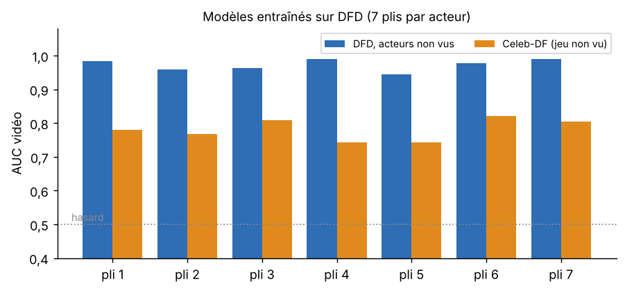

Ce que cela montre :
- L'AUC passe de 0,972 sur DFD à 0,781 sur Celeb-DF : une partie de ce que le modèle a appris est propre
  à DFD (un même ensemble de scènes de studio, une seule méthode de falsification, un seul niveau de
  compression).
- Le modèle reste nettement au-dessus du hasard (0,5) : il a aussi appris quelque chose de général.
- Le seuil ne se transfère pas : 22 à 54 % de fausses alertes sur Celeb-DF. Les résultats entre jeux de
  données doivent être lus en AUC.

### 10.4 Entraîné sur FaceForensics++, modèle complet

Entraînement sur 1 582 vidéos (714 vraies, 868 fausses), validation 690, test 695. Meilleure époque 6
(AUC vidéo de validation 0,956) ; l'entraînement s'est arrêté après l'époque 11. Environ 4,5 minutes par
époque.

| Testé sur | AUC vidéo | IC 95 % | AUC extrait |
|---|---|---|---|
| Test de FaceForensics++ | **0,967** | 0,955–0,977 | 0,940 |
| DFD (non vu) | **0,820** | 0,799–0,842 | 0,791 |
| Celeb-DF (non vu) | **0,719** | 0,672–0,764 | 0,701 |

Sur l'ensemble de test de FaceForensics++ au seuil de validation : 6/139 fausses alertes (4,3 %), 77/556
faux manqués (13,8 %), exactitude équilibrée 0,909.

Détecteurs publiés entraînés sur FaceForensics++ (AUC telle que publiée par leurs auteurs ; références au
§15) :

| Méthode | Celeb-DF | DFD |
|---|---|---|
| PhaseForensics | 0,912 | |
| AltFreezing | 0,895 | 0,985 |
| FTCN | 0,869 | 0,944 |
| RealForensics | 0,869 | |
| LipForensics | 0,824 | |
| Das et al. 2023 (images + flot optique, entraîné sur FF++ c40) | 0,802 | |
| GC-ConsFlow 2025 (résidus de flot optique) | 0,759 | |
| **Ce projet, modèle complet** | **0,719** | **0,820** |
| **Ce projet, suppression du mouvement moyen (§10.5)** | **0,739** | **0,870** |

Cette comparaison est indicative : les protocoles ne sont pas identiques (niveau de compression des
vidéos d'entraînement, AUC par image ou par vidéo, nombre de faux utilisés, vidéos exclues par le
prétraitement), et aucune de ces méthodes n'a été réentraînée ici dans les mêmes conditions.

Lecture honnête : sur des données non vues, le modèle complet est actuellement en dessous des méthodes
publiées, et sur Celeb-DF en dessous des modèles entraînés sur DFD du §10.3. Raisons probables, pas
encore testées : seule la moitié des faux de FaceForensics++ a été utilisée (500 sur 1 000 par méthode),
il n'y a aucune augmentation à part le retournement (les méthodes publiées s'entraînent sur des copies
floutées, recompressées et aux couleurs modifiées), et le modèle atteint son meilleur score de validation
très tôt (époque 6), puis s'ajuste de plus en plus à FaceForensics++.

### 10.5 Ablations sur FaceForensics++

AUC vidéo avec intervalle à 95 %.

Chaque version change un seul élément par rapport au modèle complet ; tout le reste est identique.

| Version | Question | Test FF++ | DFD | Celeb-DF |
|---|---|---|---|---|
| Modèle complet | résultat principal | 0,967 (0,955–0,977) | 0,820 (0,799–0,842) | 0,719 (0,672–0,764) |
| Images seules (`--mode rgb`) | le flot apporte-t-il quelque chose ? | 0,939 (0,920–0,955) | 0,798 (0,772–0,825) | 0,738 (0,692–0,785) |
| Flot seul (`--mode flow`) | le mouvement seul suffit-il à détecter les faux ? | 0,980 (0,970–0,988) | 0,681 (0,647–0,711) | 0,596 (0,549–0,646) |
| Sans suppression du mouvement (`--motion none`) | retirer le mouvement de la tête aide-t-il ? | 0,971 (0,960–0,981) | 0,824 (0,799–0,849) | 0,687 (0,639–0,734) |
| Suppression du mouvement moyen (`--motion mean`) | la suppression affine fait-elle mieux que celle de la moyenne ? | 0,957 (0,942–0,970) | **0,870** (0,850–0,891) | 0,739 (0,691–0,786) |
| Moyenne dans le temps (`--temporal mean`) | le LSTM aide-t-il ? | **0,986** (0,979–0,992) | 0,790 (0,763–0,814) | **0,748** (0,700–0,790) |

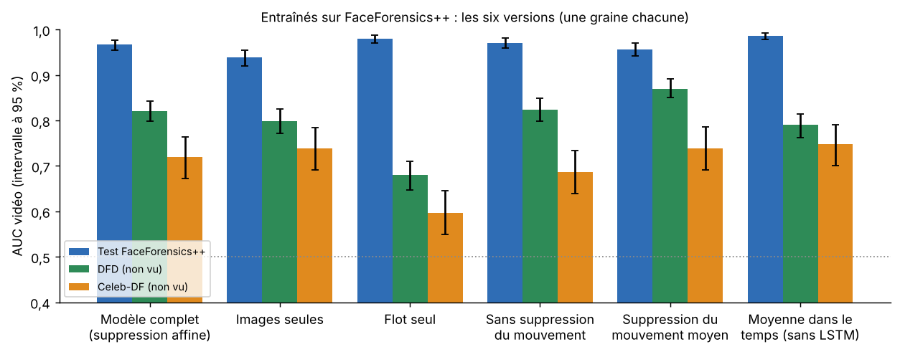

Les intervalles sur Celeb-DF font environ ±0,045, donc une différence de quelques centièmes entre deux
versions peut être due au hasard ; une affirmation demandera 2 à 3 graines.

**Lecture des six versions** (une graine chacune ; intervalles d'environ ±0,045 sur Celeb-DF et ±0,02
sur DFD).
- *Le flot et les images ensemble* aident sur DFD (0,820 contre 0,798 pour les images seules) mais pas
  sur Celeb-DF (0,719 contre 0,738). Les deux différences sont à l'intérieur des intervalles.
- *Le flot seul* est parmi les meilleurs sur FaceForensics++ (0,980) et de loin le pire sur les données
  non vues (0,681 sur DFD, 0,596 sur Celeb-DF) : le mouvement qu'il apprend est en grande partie propre à
  la façon dont les faux de FaceForensics++ ont été créés.
- *Retirer le mouvement de la tête : dans quelle mesure.* Sans suppression, avec suppression du
  déplacement moyen et avec la suppression affine complète, on obtient 0,824, **0,870** et 0,820 sur DFD,
  et 0,687, **0,739** et 0,719 sur Celeb-DF. Retirer seulement le déplacement moyen (la translation de la
  tête et du cadre) est le meilleur des trois sur les deux jeux non vus ; sur DFD, son intervalle
  (0,850–0,891) ne chevauche pas celui de la suppression affine (0,799–0,842). Une interprétation
  possible, pas encore testée : retirer une partie du mouvement aide, mais l'ajustement affine retire
  aussi du signal utile (des mouvements de la mâchoire et des joues, répartis sur le visage, qui
  ressemblent à un zoom ou à une rotation), alors que la translation seule retire surtout le mouvement
  de la tête et du cadre. C'est l'inverse de ce qui était attendu lors de la conception de la suppression
  affine, et c'est le principal enseignement des ablations.
- *La moyenne dans le temps à la place du LSTM* est la meilleure sur FaceForensics++ (0,986) et sur
  Celeb-DF (0,748, à l'intérieur des intervalles des autres), mais plus faible sur DFD (0,790). Le LSTM
  n'apporte pas de bénéfice net et constant.
- D'une version à l'autre, le score sur FaceForensics++ dit peu de choses sur le score sur les jeux non
  vus : les deux versions qui s'ajustent le mieux à FaceForensics++ (moyenne dans le temps, 0,986, et
  flot seul, 0,980) ne sont pas les meilleures sur DFD, et le flot seul est le pire sur les deux jeux non
  vus. Choisir le modèle sur le seul jeu d'entraînement ne permet pas de trouver celui qui généralise le
  mieux.
- Tout ceci repose sur une graine par version. Les deux comparaisons à répéter avec 2 à 3 graines sont la
  suppression du mouvement moyen contre la suppression affine, et le LSTM contre la moyenne dans le
  temps.

### 10.6 Résultats par méthode de falsification (test de FaceForensics++)

Chaque méthode de falsification est évaluée séparément : les 139 faux de test de la méthode contre les 139
vraies vidéos de test. AUC vidéo, calculée après coup à partir des fichiers `test_predictions.csv`
(intervalles à 95 % par 1 000 tirages bootstrap).

| Version | Deepfakes | Face2Face | FaceSwap | NeuralTextures |
|---|---|---|---|---|
| Modèle complet | 0,981 (0,966–0,994) | 0,969 (0,951–0,984) | 0,988 (0,976–0,996) | 0,929 (0,899–0,955) |
| Images seules | 0,973 | 0,946 | 0,927 | 0,909 |
| Flot seul | 0,994 | 0,986 | **1,000** | 0,939 |
| Sans suppression du mouvement | 0,975 | 0,978 | 0,992 | 0,939 |
| Suppression du mouvement moyen | 0,982 | 0,958 | 0,977 | 0,912 |
| Moyenne dans le temps | **0,991** | **0,988** | 0,999 | **0,965** |

Faux manqués par le modèle complet au seuil de validation : 7,2 % (Deepfakes), 18,0 % (Face2Face), 5,8 %
(FaceSwap), 24,5 % (NeuralTextures).

Lecture :
- **NeuralTextures est la méthode la plus difficile pour toutes les versions** (0,909 à 0,965), suivie le
  plus souvent de Face2Face. Ces deux méthodes ne remplacent pas le visage : elles modifient seulement les
  expressions, surtout la bouche. Les changements sont plus petits et plus locaux que dans un échange de
  visage complet.
- **Le flot seul obtient 1,000 sur FaceSwap**, méthode infographique qui colle un modèle 3D du visage : ses
  défauts de mouvement sont très visibles. C'est cohérent avec le §10.5 : le flot seul apprend des traces
  très propres aux méthodes de FaceForensics++, d'où un excellent score sur ce jeu et une mauvaise
  généralisation.
- La suppression du mouvement moyen, la meilleure version sur les jeux non vus, est plus faible ici sur
  Face2Face et NeuralTextures : un meilleur score sur le jeu d'entraînement ne va pas de pair avec une
  meilleure généralisation.

### 10.7 Celeb-DF : les deux types de vraies vidéos

La liste de test officielle de Celeb-DF contient deux sortes de vraies vidéos : des interviews de
célébrités (Celeb-real, 107 utilisables), à partir desquelles les faux ont été fabriqués, et des vidéos
YouTube d'autres sources (YouTube-real, 67 utilisables). AUC vidéo de chaque groupe contre les 336 faux,
calculée après coup :

| Version | Celeb-real contre faux | YouTube-real contre faux | Liste complète |
|---|---|---|---|
| Modèle complet | 0,760 | 0,654 | 0,719 |
| Suppression du mouvement moyen | 0,744 | 0,730 | 0,739 |

Le modèle complet attribue aux vraies vidéos YouTube des scores « faux » plus élevés (moyenne 0,253
contre 0,171 pour Celeb-real) : il est plus sensible au changement de source vidéo. La version à
suppression du mouvement moyen traite les deux groupes de façon plus homogène, ce qui explique une
partie de son avantage sur la liste complète. Les groupes sont petits ; ces chiffres sont indicatifs.

### 10.8 Courbes d'apprentissage et coût de calcul

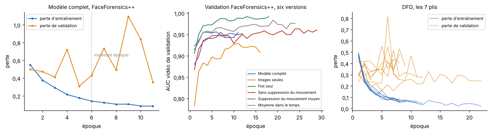

*À gauche*, le modèle complet sur FaceForensics++ : la perte d'entraînement descend régulièrement,
tandis que la perte de validation varie fortement d'une époque à l'autre (de 0,31 à 1,10), alors que
l'AUC de validation reste entre 0,94 et 0,96. Le classement des vidéos est donc stable, mais la
calibration des probabilités change beaucoup d'une époque à l'autre ; c'est une raison de sélectionner
le modèle sur l'AUC et de choisir le seuil sur la validation. *Au milieu*, l'AUC de validation des six
versions. *À droite*, les 7 plis de DFD : l'écart entre perte d'entraînement et perte de validation
apparaît dès les premières époques.

| Version (FaceForensics++) | Meilleure époque | Époques effectuées | Durée moyenne d'une époque | Durée totale |
|---|---|---|---|---|
| Modèle complet | 6 | 11 | 274 s | ≈ 50 min |
| Images seules | 11 | 16 | 126 s | ≈ 34 min |
| Flot seul | 13 | 18 | 160 s | ≈ 48 min |
| Sans suppression du mouvement | 24 | 29 | 239 s | ≈ 1 h 56 |
| Suppression du mouvement moyen | 7 | 12 | 248 s | ≈ 50 min |
| Moyenne dans le temps | 19 | 24 | 261 s | ≈ 1 h 44 |

Chaque époque comprend l'entraînement et l'évaluation de validation. Le prétraitement (détection,
suivi et RAFT) est l'étape la plus coûteuse : environ 5 à 8 s par vidéo (§10.0), soit environ 6 h pour
les 3 000 vidéos de FaceForensics++.

---

## 11. Problèmes rencontrés pendant les exécutions, et solutions

| # | Problème | Cause | Solution |
|---|---|---|---|
| P1 | Échec de l'installation de l'environnement | Python 3.15 est trop récent pour PyTorch | Python 3.10 à 3.14 requis ; `check_env` le vérifie |
| P2 | Les aperçus de test montraient la mauvaise personne, ou un visage sortant du recadrage | cadre de recadrage fixe ; plusieurs personnes dans l'image | suivi, règle du sujet principal, exclusion des images ambiguës (§3) |
| P3 | Beaucoup de fausses alertes à 0,5 sur DFD | certains acteurs réels ont un score juste au-dessus de 0,5 | seuil choisi sur les vidéos de validation |
| P4 | Les faux de FaceForensics++ de méthodes différentes s'écrasaient mutuellement | les 4 méthodes utilisent les mêmes noms de fichiers | préfixe de méthode dans les noms (`DF-`, `F2F-`, `FS-`, `NT-`) ; le préfixe ne contient pas de `_`, donc le regroupement par identité est inchangé |
| P5 | 3 des 17 premières vidéos de FaceForensics++ rejetées pour « visage trop petit » | beaucoup de vidéos de FaceForensics++ sont en basse résolution | largeur minimale de visage de 50 px pour FaceForensics++ ; les rejets pour petit visage sont tombés à 1 des 1 000 vraies vidéos |
| P6 | Le téléchargement de FaceForensics++ s'est arrêté après quelques vidéos | le script de téléchargement s'est bloqué sur un fichier | relance ; le script ignore les fichiers déjà terminés |
| P7 | La chaîne d'expériences s'est arrêtée après le premier entraînement, avec tous ses résultats enregistrés | très probablement, Python a renvoyé un code d'erreur en se fermant sous Windows | le lanceur d'expériences juge la réussite d'après les fichiers de sortie (`results.json`), pas d'après les codes de sortie |
| P8 | Un script batch Windows se fermait instantanément | une modification automatique défectueuse l'avait corrompu | réécrit ; tous les scripts batch ont ensuite été remplacés par un seul lanceur Python multiplateforme (`experiments.py`) |

---


## 12. Comment reproduire

Voir le README pour l'installation. Ensuite, avec les jeux de données dans leur organisation officielle :

```
python -m deepfake_flow.check_env
python -m deepfake_flow.experiments preprocess-dfd preprocess-celebdf preprocess-ffpp \
    --flows_dir <flows> --dfd_dir <DFD> --celebdf_dir <Celeb-DF-v2> --ffpp_dir <FaceForensics++>
python -m deepfake_flow.experiments dfd-cv dfd-to-celebdf ffpp summary \
    --flows_dir <flows> --celebdf_dir <Celeb-DF-v2>
```

Chaque chiffre de la section 10 provient des fichiers `results.json` écrits par ces commandes. Le code a
été restructuré après les exécutions ci-dessus (un seul paquet au lieu de scripts séparés, sans aucun
changement de calcul) ; sur les mêmes données et avec la même graine, le code restructuré donne des
résultats identiques aux scripts d'origine (vérifié sur un jeu de données de test : pertes, AUC et
seuils identiques).

Les jeux de données ne sont pas inclus ; ils doivent être demandés à leurs auteurs.

---

## 13. Travaux connexes et positionnement

**Jeux de données et détecteurs image par image.** FaceForensics++ [1] a établi le protocole le plus
utilisé (quatre méthodes de falsification, compression c23 et c40) et montré qu'un réseau d'images
(XceptionNet) détecte très bien les faux qu'il a vus à l'entraînement. Celeb-DF [2] a été construit avec
une méthode d'échange améliorée et montre que ces détecteurs perdent beaucoup sur des faux d'un autre
type. DFD [3] a été publié par Google et Jigsaw avec des acteurs consentants. La généralisation à des
jeux non vus est depuis la question centrale du domaine.

**Méthodes temporelles.** Des détecteurs combinent très tôt un réseau d'images et un réseau récurrent :
Güera et Delp [4] utilisent un CNN suivi d'un LSTM, Sabir et al. [5] des stratégies récurrentes sur des
visages alignés. Des méthodes plus récentes cherchent à forcer le réseau à utiliser l'information
temporelle plutôt que l'apparence : FTCN [6] réduit la taille spatiale des convolutions à 1 pour ne
garder que la cohérence temporelle, LipForensics [7] et RealForensics [8] apprennent le mouvement de la
bouche à partir de vidéos de lecture labiale ou de vraies personnes qui parlent, et AltFreezing [9]
alterne l'entraînement des poids spatiaux et temporels. Ce sont actuellement parmi les meilleures
méthodes en généralisation vers Celeb-DF (§10.4).

**Flot optique et mouvement.** Amerini et al. [10] ont été parmi les premiers à classer directement des
cartes de flot optique avec un CNN ; Saikia et al. [11] combinent flot optique, CNN et LSTM ; Das et
al. [12] utilisent deux transformers, l'un sur les images et l'autre sur le flot. PhaseForensics [13]
remplace le flot optique par une représentation du mouvement fondée sur la phase de bandes de fréquence
de sous-régions du visage, et obtient la meilleure généralisation vers Celeb-DF de cette liste.
GC-ConsFlow [14] est le travail le plus proche de celui-ci : il utilise des *résidus de flot optique*
précisément pour atténuer le mouvement naturel du visage, avec un second flux sur l'apparence.

**Positionnement de ce projet.** Ce projet reprend une architecture simple à deux flux, image et flot
[15], avec ResNet18 [16] et un LSTM [17], et se concentre sur une question précise : *combien* du
mouvement de la tête faut-il retirer du flot avant de l'analyser ? La suppression explicite et
paramétrique du mouvement rigide (translation ou ajustement affine par moindres carrés), comparée en
ablation contrôlée à l'absence de suppression, n'a pas été trouvée dans la littérature consultée. GC-ConsFlow poursuit toutefois un objectif voisin par un autre moyen, et la littérature
n'a pas été parcourue de façon exhaustive : cette nouveauté doit être vérifiée plus largement avant toute
publication. L'apport principal est donc moins un nouveau détecteur qu'une mesure soigneusement
contrôlée (découpage par identité, ensembles de test officiels, intervalles de confiance, ablations
changeant un seul élément), avec un résultat inattendu : retirer seulement la translation généralise
mieux que l'ajustement affine.

---

## 14. Limites et menaces à la validité

- **Une seule graine par version sur FaceForensics++.** Les intervalles du §10.5 mesurent la variation due
  aux vidéos de test, pas celle due à l'entraînement (initialisation, ordre des lots). L'écart entre
  suppression du mouvement moyen et suppression affine sur DFD (0,870 contre 0,820, intervalles
  disjoints) est le résultat le plus solide, mais il doit être confirmé avec 2 à 3 graines ; les écarts
  de quelques centièmes sur Celeb-DF ne permettent aucune conclusion.
- **Sous-échantillonnage.** 500 des 1 000 faux par méthode de FaceForensics++, 1 000 des 3 068 faux de DFD
  et 1 500 des 5 639 faux de Celeb-DF ont été prétraités (les ensembles de test officiels sont, eux,
  complets). Plus de données d'entraînement pourrait changer les scores et peut-être le classement des
  versions.
- **Vidéos exclues.** Les résultats portent sur les vidéos utilisables (510 sur 518 pour Celeb-DF, 695 sur
  700 pour FaceForensics++). Un détecteur utilisé en pratique devrait aussi traiter les plans à deux
  personnes et les profils, que la chaîne actuelle écarte.
- **Comparaison avec la littérature indicative** (§10.4) : protocoles différents, aucune méthode
  réentraînée dans les mêmes conditions.
- **Robustesse non testée.** Seule la compression c23 a été utilisée ; la forte compression (c40), le flou,
  le redimensionnement et les perturbations adverses n'ont pas été évalués.
- **Hyperparamètres choisis par raisonnement** (§3.4, §7), sans recherche systématique ; d'autres valeurs
  (longueur des extraits, cadence, taille d'entrée) pourraient donner de meilleurs résultats.
- **Explication non vérifiée.** L'idée que l'ajustement affine retire une partie du signal utile
  (mouvements de la mâchoire et des joues) est une hypothèse ; elle pourrait être testée, par exemple en
  mesurant l'énergie du résidu par région du visage pour chaque réglage.
- **Seuil non transférable** entre jeux de données (§10.3) : un usage réel demanderait un étalonnage sur
  des données du domaine visé.
- **Coût de calcul.** RAFT rend le prétraitement lent (5 à 8 s par vidéo sur la machine utilisée), ce qui
  limite un usage en temps réel.
- **Jeux de données datés** (2019–2020). Les falsifications récentes (modèles de diffusion, réanimation de
  visage à partir d'une seule image) n'ont pas été testées.
- **Analyses faites après coup.** Les résultats par méthode (§10.6) et par type de vraie vidéo (§10.7) ont
  été calculés après les expériences, à partir des prédictions enregistrées ; ils servent à comprendre les
  résultats, pas à choisir un modèle.

---

## 15. Références

Jeux de données et méthodes comparées

1. A. Rössler, D. Cozzolino, L. Verdoliva, C. Riess, J. Thies, M. Nießner. *FaceForensics++: Learning to
   Detect Manipulated Facial Images.* ICCV 2019.
2. Y. Li, X. Yang, P. Sun, H. Qi, S. Lyu. *Celeb-DF: A Large-scale Challenging Dataset for DeepFake
   Forensics.* CVPR 2020.
3. N. Dufour, A. Gully. *Contributing Data to Deepfake Detection Research.* Google AI Blog, septembre 2019
   (jeu DeepFakeDetection, distribué avec FaceForensics++).
4. D. Güera, E. J. Delp. *Deepfake Video Detection Using Recurrent Neural Networks.* AVSS 2018.
5. E. Sabir, J. Cheng, A. Jaiswal, W. AbdAlmageed, I. Masi, P. Natarajan. *Recurrent Convolutional
   Strategies for Face Manipulation Detection in Videos.* CVPR Workshops 2019.
6. Y. Zheng, J. Bao, D. Chen, M. Zeng, F. Wen. *Exploring Temporal Coherence for More General Video Face
   Forgery Detection* (FTCN). ICCV 2021.
7. A. Haliassos, K. Vougioukas, S. Petridis, M. Pantic. *Lips Don't Lie: A Generalisable and Robust
   Approach to Face Forgery Detection* (LipForensics). CVPR 2021.
8. A. Haliassos, R. Mira, S. Petridis, M. Pantic. *Leveraging Real Talking Faces via Self-Supervision for
   Robust Forgery Detection* (RealForensics). CVPR 2022.
9. Z. Wang, J. Bao, W. Zhou, W. Wang, H. Li. *AltFreezing for More General Video Face Forgery Detection.*
   CVPR 2023.
10. I. Amerini, L. Galteri, R. Caldelli, A. Del Bimbo. *Deepfake Video Detection through Optical Flow
    based CNN.* ICCV Workshops 2019.
11. P. Saikia, D. Dholaria, P. Yadav, V. Patel, M. Roy. *A Hybrid CNN-LSTM Model for Video Deepfake
    Detection by Leveraging Optical Flow Features.* arXiv:2208.00788, 2022.
12. S. Das, M. Kolahdouzi, L. Özparlak, W. Hickie, A. Etemad. *Unmasking Deepfakes: Masked Autoencoding
    Spatiotemporal Transformers for Enhanced Video Forgery Detection.* arXiv:2306.06881, 2023.
13. E. Prashnani, M. Goebel, B. S. Manjunath. *Generalizable Deepfake Detection with Phase-Based Motion
    Analysis* (PhaseForensics). IEEE Transactions on Image Processing, vol. 34, p. 100–112, 2025
    (arXiv:2211.09363, 2022).
14. J. Chen, M. Hu, D. Zhang, J. Meng. *GC-ConsFlow: Leveraging Optical Flow Residuals and Global Context
    for Robust Deepfake Detection.* arXiv:2501.13435, 2025.

Composants utilisés

15. K. Simonyan, A. Zisserman. *Two-Stream Convolutional Networks for Action Recognition in Videos.*
    NeurIPS 2014.
16. K. He, X. Zhang, S. Ren, J. Sun. *Deep Residual Learning for Image Recognition* (ResNet). CVPR 2016.
17. S. Hochreiter, J. Schmidhuber. *Long Short-Term Memory.* Neural Computation, 9(8), 1997.
18. Z. Teed, J. Deng. *RAFT: Recurrent All-Pairs Field Transforms for Optical Flow.* ECCV 2020.
19. D. J. Butler, J. Wulff, G. B. Stanley, M. J. Black. *A Naturalistic Open Source Movie for Optical Flow
    Evaluation* (Sintel). ECCV 2012.
20. W. Wu, H. Peng, S. Yu. *YuNet: A Tiny Millisecond-level Face Detector.* Machine Intelligence Research,
    2023.
21. J. Deng, W. Dong, R. Socher, L.-J. Li, K. Li, L. Fei-Fei. *ImageNet: A Large-Scale Hierarchical Image
    Database.* CVPR 2009.
22. I. Loshchilov, F. Hutter. *Decoupled Weight Decay Regularization* (AdamW). ICLR 2019.
23. W. J. Youden. *Index for Rating Diagnostic Tests.* Cancer, 3(1), 1950.
24. B. Efron, R. J. Tibshirani. *An Introduction to the Bootstrap.* Chapman & Hall, 1993.
25. F. Pedregosa et al. *Scikit-learn: Machine Learning in Python.* JMLR, 12, 2011.
